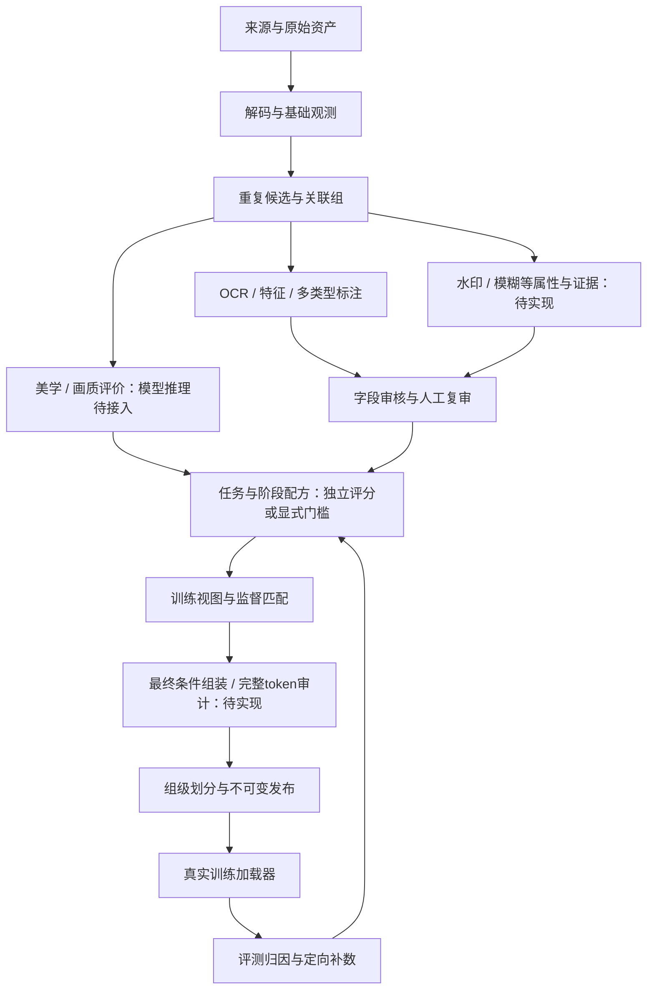

# ImageDataProcessPipeline

面向图像生成模型训练的数据处理框架设计：共享原始资产，按任务、领域与训练阶段生成可追溯的数据版本。

2026-10-26：[v0.12双评分关闭测速](docs/imagecaption-v0.12-status.md)：新配方短边512，保留其余门槛、默认裁剪与JoyCaption三档；node94单5090处理16张完整构建8分30秒，约113张/小时。实际裁剪0（水印未确认），48条描述仍待审，不代表实际裁图或四卡生产吞吐。

2026-10-26：[node94 Huihui Caption 独立 Demo](docs/huihui-caption-demo-node94.md)已部署，完成 BF16/INT8/NF4 同卡合成测速及网页核验；当前 BF16 最快，NF4 更省显存。该试验不替代真实语义质量或生产吞吐验收。

2026-10-25：追加[版本结果查看](docs/imagecaption-v0.11-status.md)，按版本接入完整审阅包，提供图片、描述、裁剪、评分与标签的只读检查；进度和诊断仍不加载私有内容。

2026-10-25：[v0.10 网页整理与只读配置](docs/imagecaption-v0.10-status.md)已实现阶段列表与单项详情、四个主入口、五组配置摘要和独立同步。202项回归、修正后19项配置专项及685项合成浏览器检查通过；本地网页更新，node95部署、真实质量和GPU吞吐不在本轮验收范围。

2026-10-24：[v0.9模块化推理与吞吐](docs/imagecaption-v0.9-status.md)已实现模型配置/阶段绑定、OpenAI兼容多端点及有界并行。154项本地回归与31项数据库集成通过；合成延迟基准四并发墙钟比3.57，不代表实际GPU收益。GBC暂不实施，node95新部署与四卡吞吐待验收。

2026-10-24 更新：[v0.8 网页流程与状态修正](docs/imagecaption-v0.8-status.md)已同步运行时分支并更新本地服务；[Togeari 执行层评估](docs/togeari-execution-assessment.md)给出有界并行、分桶与四卡试点建议，尚未引入框架或验证其加速收益。

**历史工作：ImageCaption v0.7裁剪开关、元信息与可选标签已实现并同步。** 只为实际裁后视图生成三档描述，保留原图溯源；标签限非露骨封闭分类，默认关闭且始终待审。172项专项回归和最终32项定向回归、420项合成UI检查通过；新增标签尚无真实GPU或语义质量验收。标准README与完整启动/核验手册已同步运行时仓库，见[v0.7记录](docs/imagecaption-v0.7-status.md)。

**上一轮：ImageCaption v0.6初代审阅版已生成并校验。** 新增默认关闭的review候选三档草稿开关及独立审阅导出，生成草稿不改变审核或训练准入。116项Workbench回归和93项本轮合成UI检查通过；node95完成32张原版、三个评分开关版本、实际网络中断恢复及短描述修订版v0005。最终32张/96条描述的私有审阅包已下载到本地并校验，全部样本仍待审。独立8张对照56次模型调用全成功，完整构建22.66分钟，其中模型身份校验11.04分钟；这是共享主机的小批启动测试，生产容量和四卡吞吐仍未验证。当前证据见[v0.6记录](docs/imagecaption-v0.6-status.md)，验收任务见[当前change](openspec/changes/build-imagecaption-data-workbench/tasks.md)。

定制旧direct全阶段进度、真实质量校准仍待验收，助手不查看真实图片、caption或OCR。[v0.5记录](docs/imagecaption-v0.5-status.md)、[v0.4记录](docs/imagecaption-v0.4-status.md)、[v0.3记录](docs/imagecaption-v0.3-status.md)与[v0.2记录](docs/imagecaption-v0.2-status.md)保留为历史，各轮测试和计量不合并成新的性能结论。

**原通用底座状态：框架规格已建立，按OpenSpec持续实施，已完成21/70项，与ImageCaption产品独立统计。** 本地有完整项目源码、规格与测试，整个系统尚未全部实现。原底座已有接入、持久CPU处理、视图、数值质量观测、精确重复来源簇、版本化选择配方与评分导入，以及最小T2I manifest/sidecar发布和实际读取；其评分/标注模型、预算、GC、完整课程与多任务发布仍待实施。

ImageCaption现已加入原始文件密度门控：参考值0.15 byte/pixel，可通过配方或CLI调整/关闭；裁后重编码不替代原始证据。已有prompt的[语义标签模型选型](docs/research-evidence.md#prompt语义标签化模型选型2026-10-22)已完成调研，标签器尚未部署或验收。

当前优先使用[Windows本地操作手册](docs/local-runbook.md)，运行`idp demo`可用合成素材完成接入→处理→发布→实际读取。其他说明见[M0指南](docs/m0-guide.md)、[node95操作手册](docs/node95-runbook.md)、[持久处理与恢复](docs/durable-processing.md)及[实施状态](docs/implementation-status.md)。`idp --help`列出的命令可运行；设计文档中的其他命令与配方不代表已实现。

原通用底座于2026-10-18新增最小发布与本地合成闭环，验证记录见实施状态。node95此前离线，2026-10-22已恢复只读连接；本仓库第三轮起的新代码及迁移仍未完成远端部署验收，最后确认的DataPipeline部署为第二轮。该轮未将真实图片与95业务数据库复制到本机；ImageCaption后续独立部署与试点见上方产品记录。

原底座同日追加选择配方与v6迁移：固定模型/配置/输入版本，区分宽保留与评分门槛，将决策绑定发布；该底座的美学和画质模型真实推理仍待接入，此轮未在95部署。

2026-10-22完成[水印监督与完整条件链路复核](docs/research-evidence.md#watermark-conditioning-audit)：MOSS宽保留同时使用属性监督和推理负向条件。原通用底座的评分引用不自动进入训练文本；随后ImageCaption v0.3已实现视图属性、完整条件和参考加载器消费，外部训练器与实际控制收益仍待验收。

## 阅读入口

- [ImageCaption v0.10网页整理与配置展示](docs/imagecaption-v0.10-status.md)
- [ImageCaption v0.7裁剪、标签与启动核验](docs/imagecaption-v0.7-status.md)
- [ImageCaption v0.6验收与审阅交付](docs/imagecaption-v0.6-status.md)
- [ImageCaption最新产品提案](openspec/changes/build-imagecaption-data-workbench/proposal.md)
- [CLI与看板、处理流程及版本设计](openspec/changes/build-imagecaption-data-workbench/design.md)
- [看板行为与进度口径规格](openspec/changes/build-imagecaption-data-workbench/specs/imagecaption-cli-progress/spec.md)
- [ImageCaption分阶段实施任务](openspec/changes/build-imagecaption-data-workbench/tasks.md)
- [标签、三档描述与加速研究](docs/caption-tagging-and-throughput-review.md)
- [看板使用与排错手册](https://github.com/lililuya/ImageCaption/blob/codex/imagecaption-workbench-v0.2/docs/workbench-dashboard-guide.md)
- [提案与能力范围](openspec/changes/design-image-data-framework/proposal.md)
- [技术设计与架构图](openspec/changes/design-image-data-framework/design.md)
- [十项能力规格](openspec/changes/design-image-data-framework/specs/)
- [分阶段实施与验收任务](openspec/changes/design-image-data-framework/tasks.md)
- [论文、模型资料与工程映射（含MOSS-Image分析）](docs/research-evidence.md)
- [数据契约与配方示例](docs/contracts.md)
- [版本化选择配方与评分接入](docs/recipes.md)

## 目标全流程

下图是原通用框架的目标流程，包含待实施环节；各能力现状以实施状态和CLI帮助为准。最新ImageCaption流程及水印裁剪策略见[新设计](openspec/changes/build-imagecaption-data-workbench/design.md)。



支持范围设计包含纯图像、T2I、文字排版、单图/多图编辑、透明图像、风格LoRA和偏好数据。核心原则是观测与筛选分离、原图与训练视图分离、执行失败与质量结论分离。

水印等属性有独立的观测、监督和选样用途。配方决定保留并标注、精选或复审；不预设全局删除/擦除。用于控制生成的属性还必须进入训练器实际消费的条件，仅保存分数或数据库元数据不足以实现控制。

## OpenSpec工作流

使用[OpenSpec](https://github.com/Fission-AI/OpenSpec)，固定版本1.14.2。需要Node.js≥20.19和npm：

```powershell
npm ci
npm run spec:validate
npm run spec:status
```

也可直接调用：

```powershell
node node_modules/@fission-ai/openspec/bin/openspec.js status --change design-image-data-framework
node node_modules/@fission-ai/openspec/bin/openspec.js status --change build-imagecaption-data-workbench
node node_modules/@fission-ai/openspec/bin/openspec.js validate --all --strict
```

`design-image-data-framework`记录原底座的21/70项实施进度，`npm run spec:status`仍指向该change。`build-imagecaption-data-workbench`是当前产品方向，v0.3为38/40项，v0.4追加模块审核、质量开关、文件密度门控与标签选型后为48/50项；v0.5研究、看板与恢复验收后为52/54项。v0.6完成待复核草稿、单卡形式试点及审阅交付后为58/60项；v0.7补齐第12组后为61/63项；定制旧direct进度和真实人工质量校准继续未完成。通过上面的显式命令及tasks查看最新状态。已验收任务逐项勾选，其余保持未完成，全部验收后再archive。`openspec/specs/`在归档前为空，当前规格位于change内部，避免把未实现行为当成现状。

`.agents/skills/`为CLI生成的Codex工作流。Git仅同步代码、规格与小型合成测试数据，真实图像、产物、模型和凭据保存在仓库外。远程仓库：[lililuya/ImageDataProcessPipeline](https://github.com/lililuya/ImageDataProcessPipeline)。

## 实施顺序

| 阶段 | 交付目标 |
|---|---|
| M0 | 契约、合成夹具、抽样审计与容量基准 |
| M1 | 接入、存储、持久任务、基础处理与最小发布闭环 |
| M2 | 分层去重、标注审核、训练视图、配方与覆盖审计 |
| M3 | 多任务、训练适配、完整发布与读取性能 |
| M4 | 模型对照、补数反馈、接口、故障恢复与规模验收 |

具体数据量、资源、推理模型、预算和训练器在试点部署时绑定；设计不预设未经验证的吞吐、筛选阈值或训练配比。
