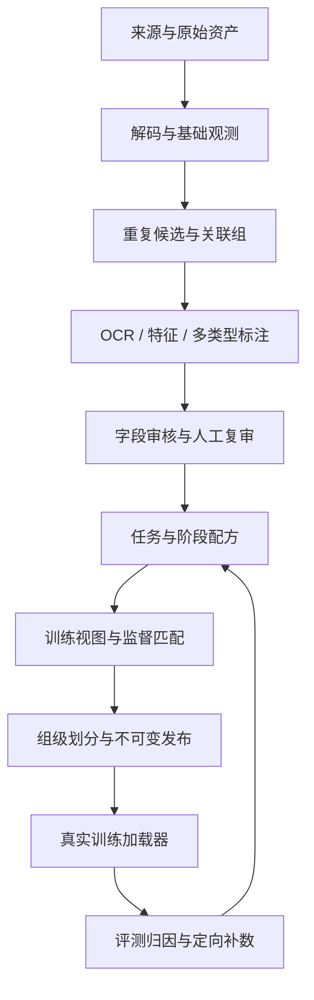

# ImageDataProcessPipeline

面向图像生成模型训练的数据处理框架设计：共享原始资产，按任务、领域与训练阶段生成可追溯的数据版本。

**当前状态：设计已完成，M0/M1基础能力持续实施并部署到node95。** 已有数据契约、合成夹具、分层审计、本地接入、PostgreSQL目录、有界解码worker、资源池、租约、有限重试及持久观测；标注模型、预算、GC与训练发布仍待实施。

实际使用见[M0指南](docs/m0-guide.md)、[node95操作手册](docs/node95-runbook.md)、[持久处理与恢复](docs/durable-processing.md)及[实施状态](docs/implementation-status.md)。`idp --help`列出的命令可运行；设计文档中的其他命令、配方与manifest仍为拟议接口。

2026-10-17新增[训练视图与质量观测](docs/views-quality.md)，已通过本地50项测试（含真实隔离PostgreSQL 17）。node95本轮SSH连接超时，新代码和数据库v4迁移尚未部署到该机；其最后确认版本仍为前一轮。

## 阅读入口

- [提案与能力范围](openspec/changes/design-image-data-framework/proposal.md)
- [技术设计与架构图](openspec/changes/design-image-data-framework/design.md)
- [十项能力规格](openspec/changes/design-image-data-framework/specs/)
- [分阶段实施与验收任务](openspec/changes/design-image-data-framework/tasks.md)
- [论文、模型资料与工程映射](docs/research-evidence.md)
- [数据契约与配方示例](docs/contracts.md)

## 全流程



支持范围设计包含纯图像、T2I、文字排版、单图/多图编辑、透明图像、风格LoRA和偏好数据。核心原则是观测与筛选分离、原图与训练视图分离、执行失败与质量结论分离。

## OpenSpec工作流

使用[OpenSpec](https://github.com/Fission-AI/OpenSpec)，固定版本1.14.2。需要Node.js≥20.19和npm：

```powershell
npm ci
npm run spec:validate
npm run spec:status
```

也可直接调用：

```powershell
node node_modules/@fission-ai/openspec/bin/openspec.js status --change design-image-data-framework
node node_modules/@fission-ai/openspec/bin/openspec.js validate --all --strict
```

当前change是`design-image-data-framework`：proposal/specs/design/tasks均已准备；已验收任务逐项勾选，其余保持未完成。当前正在通过`$openspec-apply-change`实施，全部验收后再archive。`openspec/specs/`在归档前为空，当前规格位于change内部，避免把未实现行为当成现状。

`.agents/skills/`为CLI生成的Codex工作流。Git仅同步代码、规格与小型合成测试数据，真实图像、产物、模型和凭据保存在仓库外。远程仓库：[lililuya/ImageDataProcessPipeline](https://github.com/lililuya/ImageDataProcessPipeline)。

## 实施顺序

| 阶段 | 交付目标 |
|---|---|
| M0 | 契约、合成夹具、抽样审计与容量基准 |
| M1 | 接入、存储、持久任务、基础处理与最小发布闭环 |
| M2 | 分层去重、标注审核、训练视图、配方与覆盖审计 |
| M3 | 多任务、训练适配、完整发布与读取性能 |
| M4 | 模型对照、补数反馈、接口、故障恢复与规模验收 |

具体数据量、资源、推理模型、预算和训练器在试点部署时绑定；设计不预设未经验证的吞吐、筛选阈值或训练配比。
