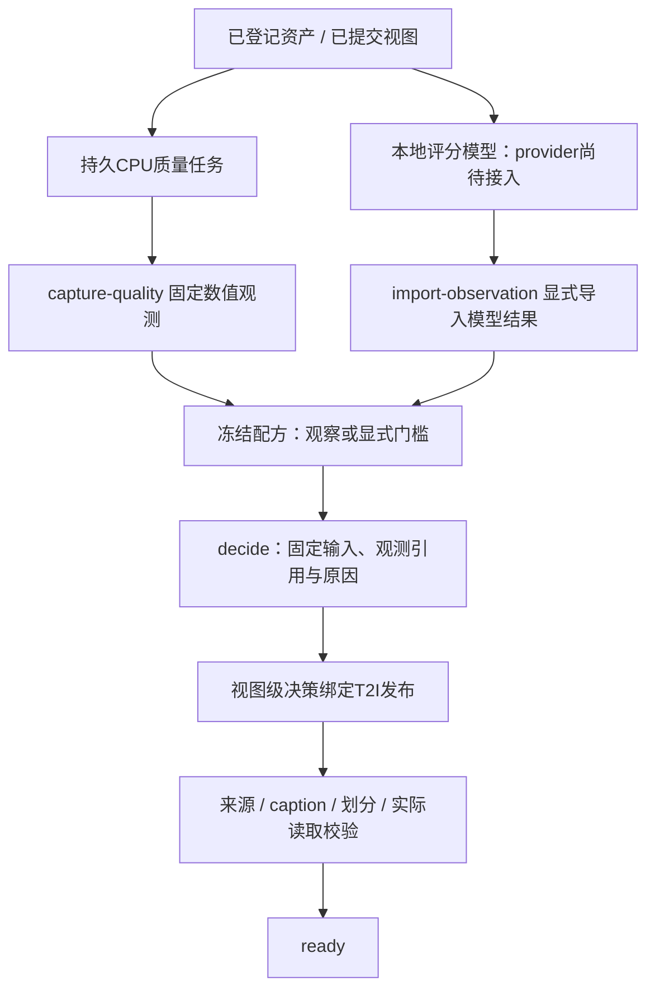

# 版本化选择配方与评分接入

本轮对应任务7.4。已实现配方解析、默认值冻结、观测版本引用、独立原因码与最小T2I发布绑定。多领域阈值路由、采样配额、caption权重、风格投影和完整八层执行仍在7.5–7.7；不能将本轮选择器称为完整课程引擎。

## 当前数据流



评分接口已可表达美学、技术画质等独立数值，**ArtiMuse、DeQA真实推理尚未接入，也未验证质量收益**。`import-observation`只登记调用方提供的结果和版本声明，不能证明它由指定权重真实计算。合成测试的分数、模型摘要、校准引用均是测试夹具，不是模型结果。

## 配方与观测身份

`Recipe`保存名称、版本、领域、阶段、任务、seed、校准声明、观测绑定、规则、必需标注/审核引用、视图配置和可选模型适配声明。所有默认值展开后生成摘要，存入`recipes`，不按同名配方覆盖。seed在本轮仅冻结记录，不表示已执行随机采样。适配声明检查任务能力，不表示目标训练器已实际运行。

每个观测绑定固定完整`OperatorSpec`：算子ID/版本、模型摘要、配置摘要、输入/输出schema、资源与batch上限。模型摘要须由实际权重清单计算，配置摘要应覆盖预处理、输入大小、归一化、输出尺度和推理参数；本接口保存并匹配声明，不自动检查外部模型文件。不得把ArtiMuse、DeQA或不同输出尺度的分数当作同一特征。配置或模型变化形成新的观测、配方及决策，旧版本仍可查询。

`FeatureObservation`记录资产、可选view_id、实际输入checksum、producer、来源引用、状态与独立metrics。`status`区分`ok / unsupported / failed`；后两者须带error_code且不能带分数。缺失指标为null，真实0保留；bool、字符串、NaN和Infinity拒收。原图观测不能满足`scope=view`；`scope=asset`明确表示该规则使用原资产观测，不声称它评价了裁剪后的画面。注册时检查资产/视图/输出摘要相符。

观测、配方与决策均为追加版本。`decide`只读取输入中显式指定的观测ID，从不自动选择“最新”模型；观测引用、规则和绑定名称、阈值及测量值写入决策。外部更改目录内容导致摘要不一致时拒绝读取。观测引用使用数据库外键，决策与引用在一个事务提交。

## 宽保留与精选

- 宽保留：绑定评分时可设`required=false`，不配置该分数的规则；有分数就保存证据，缺失或模型失败不自动淘汰。结果仍须经过来源和监督检查。
- 精选：规则显式指定绑定、指标、`ge/le`及阈值；阈值为null返回`needs_calibration`。数值存在但低于门槛才是`reject`，执行失败或缺失为`needs_observation`。
- 必需标注或审核版本未提供为`needs_review`；已知失败规则优先产生reject，其余诊断仍保留。全部选择条件满足才为accept。
- `calibrated=true`必须有校准证据引用且阈值已填写。它是操作者声明，系统不自动证明证据有效；人工基准和误删率需另做验收。未校准的数值accept可用于检查，带门槛的发布必须通过已声明校准的规则。无门槛宽保留发布不构成图像质量认可。

这实现了[研究依据](research-evidence.md)提出的“保留观测、按训练阶段决定准入”基础：可以分别表达MOSS式宽保留和LLaDA式精选，未复制其未知细节，也未将论文阈值设为默认值。

## 本地命令

先配置本地数据库并执行`idp db migrate`，迁移仅追加v6。旧v1–v5摘要保持不变，已有v5发布的ID和manifest不因新字段的默认空值而改变。

```powershell
# 从已成功提交的CPU质量任务生成固定观测，不重新读取图片
idp recipe capture-quality TASK_KEY
idp recipe observation OBSERVATION_ID

# 外部评分仅显式导入；不访问服务、不下载模型、不自动分析真实素材
idp recipe import-observation local-score.json

idp recipe freeze configs/recipe-broad-unverified.json
idp recipe inspect RECIPE_DIGEST
idp recipe decide RECIPE_DIGEST --input selection-input.json
idp recipe decision DECISION_ID
```

`selection-input.json`结构：

```json
{
  "subject": {"asset_id": "sha256:<原始字节摘要>", "view_id": "sha256:<固定视图ID>", "checksum": "sha256:<视图输出摘要>"},
  "observation_refs": {},
  "annotation_refs": [],
  "review_refs": []
}
```

占位值必须替换为真实目录中的64位小写十六进制摘要。`observation_refs`为配方绑定名到观测ID的映射。完整JSON Schema可通过`idp.curation.recipes`中`Recipe / FeatureObservation / SelectionInput`的`model_json_schema()`读取。CLI只输出数值、引用及版本；不会展示图片或生成caption。

以已有CPU观测创建带门槛的检查配方，可使用Python接口取得其真实producer，避免手抄环境配置摘要：

```python
from idp.curation.recipes import Binding, Recipe, Rule
from idp.execution.operators import OperatorSpec

# captured = Recipes(catalog).get_observation(observation_id)
recipe = Recipe(name="numeric-pilot", version="1", domain="pilot", stage="selected",
                task_type="t2i",
                observations=(Binding(name="numeric", scope="asset", required=True,
                                      producer=OperatorSpec.model_validate(captured["producer"])),),
                rules=(Rule(rule_id="min-entropy", observation="numeric",
                            metric="entropy_luma", operator="ge", value=None),))
```

该例阈值尚未填写，结果为needs_calibration。美学和画质模型接入后也遵循相同版本与引用规则，但熵、拉普拉斯方差不能替代这些模型。

## 绑定最小T2I发布

计划的`selection.recipe_digest`填写已冻结配方摘要，每个member的`decision_id`填写针对该视图/输出的决策。两者必须同时出现；不提供时沿用既有手工选择路径，既有发布摘要保持兼容。发布会验证：决策为accept、配方一致、任务相符、视图/输出一致，决策宣称的标注/审核引用属于当前成员；有门槛的配方已声明校准。模型适配声明存在时也须检查通过。

manifest记录`recipe_digest / decision_ref`，目录中保留决策到观测的引用。发布仍独立校验来源、许可、caption、划分、文件摘要和实际读取，评分accept不能绕过它们。旧手工选择路径仍允许操作者显式发布；本轮尚未实现强制所有发布使用配方的管理策略、完整权限或人工审核器。

本地验证使用合成素材和隔离PostgreSQL，覆盖模型版本变化、错误视图、零分/缺失/失败、宽保留/精选、并发重放、事务失败恢复、v5发布兼容、CLI及来源撤回。测试结果见[实施状态](implementation-status.md)。95仍离线，本轮没有远程部署或真实图片处理。
