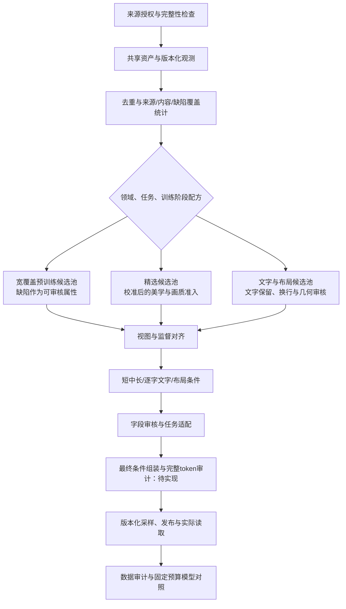

# 研究依据与工程映射

基础资料核查日期：2026-10-15；2026-10-18追加MOSS-Image技术报告分析，2026-10-22复核其水印监督、官方推理代码与本项目条件链路，同日重核LLaDA文件密度门槛并追加prompt标签模型选型，其他资料不因此视为重新核查。本文是选定公开资料的工程分析，不宣称覆盖所有最新版本。论文按完整技术报告阅读，重点评估数据流程可复现性；不做投稿接收判断。公开方法、工程推断和未公开信息分别标记。

| 资料 | 公开依据 | 本项目工程推断 | 边界 |
|---|---|---|---|
| [LLaDA-Image §3–4、附录D](https://arxiv.org/html/2609.03796) | 纯图像阶段先于图文SFT；条件来自实际图像；分字段caption审核，编辑指令核对方向 | 素材与标注分离，视图绑定监督，字段重做，image-only兼容检查 | 模型结构须支持相应条件机制；论文阈值需校准 |
| [LLaDA 官方仓库](https://github.com/inclusionAI/LLaDA-Image) | 训练代码仍标 coming soon | 按行为契约重新实现可恢复流水线 | 推理代码不等于完整数据流水线 |
| [Qwen-Image-2.0 §2](https://arxiv.org/html/2605.10730) | 通用/文字/知识/结构化描述，分阶段处理及错误驱动数据反馈 | 任务化标注与审核、错误taxonomy、补数版本对照 | 不能把前代报告直接写成2.1配方 |
| [Qwen-Image-2.1 官方说明](https://qwen.ai/blog?id=qwen-image-2.1) | 统一生成编辑、原生透明图、最多十张参考图 | alpha、图像角色和输入顺序成为契约字段 | 能力说明不是完整数据集或训练混合比例 |
| [Krea 2 技术报告 Data / Data infrastructure](https://www.krea.ai/blog/krea-2-technical-report) | 强调多样性；OCR辅助caption；分阶段去重与筛选；元数据和对象引用分离、持久状态驱动处理 | 保留独立分数、覆盖审计、算子成本分层、持久任务 | 不照搬其规模，也不把美学分作为所有领域统一门槛 |
| [Krea 模型卡](https://huggingface.co/krea/Krea-2-Raw) | 整体训练数据包含合成数据 | 真实/合成/未知及阶段分别追踪 | 报告中的无合成图限定预训练，不能扩大到全部后训练 |
| [FLUX klein 官方风格指南](https://docs.bfl.ai/flux_2/flux2_klein_training_example) | 特定风格LoRA示例采用内容caption、触发词和省略风格描述 | 基础标注保留完整，导出时按目标投影 | 教程示例不能替代通用预训练配方 |
| [BFL Base 微调说明](https://help.bfl.ai/articles/7108141705-can-i-run-or-fine-tune-flux-2-klein-locally) | 推荐未蒸馏Base作为微调起点 | target checkpoint是配方兼容条件 | 不能推断完整基础模型数据来源与规模 |
| [MOSS-Image §3、附录B/C/G/H](https://github.com/OpenMOSS/MOSS-Image/blob/c1355e6b1986dfe8fba3c0455783a05899212342/paper/MOSS_Image_Technical_Report.pdf) | 来源预处理后去重与AI图检测；宽保留语料并标注缺陷；多粒度caption、逐字文字和结构化布局；额外过滤有早期消融 | 评分与淘汰分离，宽覆盖与高质量配方并存，保留换行并绑定视图几何，评价区分文字覆盖、布局与人工偏好 | 额外过滤消融未单独测试ArtiMuse/DeQA；“无额外过滤”不代表无来源预处理；阶段表存在版本不一致 |

## 参考阈值如何处理

LLaDA 报告的像素数大于1024²、文件大小/像素至少0.15 byte/pixel、ArtiMuse≥60、DeQA≥4.0，仅作为待验证参考。[依据](https://arxiv.org/html/2609.03796)

2026-10-22再次核对§3.2：论文在metadata filtering阶段使用该文件比值，之后才裁剪与缩放。本项目按用户要求将0.15纳入可调整配方，计算`original_file_bytes / (original_width × original_height)`，等于门槛时通过本项。原始身份绑定、CLI关闭、缺失处理和版本冻结是本项目的工程设计；不是论文公开实现。1 byte=8 bits，0.15 byte/pixel相当于1.2 bit/pixel；不把两者混用，也不以转PNG后的增大体积替代原始编码证据。[论文§3.2](https://arxiv.org/html/2609.03796#S3.SS2)

实施时先保留连续分数与来源分布，在人工审计集测量误删，再按领域和阶段选择阈值。文件字节/像素受编码格式影响；截图、设计图、透明素材与摄影图应分别检查。未加载对应模型且未复核分数量纲时，不启用数值阈值。

MOSS-Image补充了另一种预训练选择：在来源预处理、去重和AI图检测后宽保留语料，用标注描述模糊、水印、压缩伪影等属性。其早期实验显示一组联合启发式过滤会损伤文字能力。因此，美学与画质应成为独立、版本化的评价模块，是否作为准入门槛由领域、任务和阶段配方决定。LLaDA式精选与MOSS式宽保留可以基于共享资产形成不同发布；二者都不能绕过来源授权、隐私治理和完整性要求。以下给出证据与限制。

## MOSS-Image 数据工程分析

### 阅读范围与版本

- 资料为官方仓库的《MOSS-Image Technical Report》，按完整技术报告进行数据工程审读。
- 读取官方35页PDF的正文及附录，渲染核对图3、表1及附录B的过滤实验；仓库版本固定为`c1355e6b1986dfe8fba3c0455783a05899212342`。[官方报告](https://github.com/OpenMOSS/MOSS-Image/blob/c1355e6b1986dfe8fba3c0455783a05899212342/paper/MOSS_Image_Technical_Report.pdf)
- PDF为32,234,760字节，SHA-256为`e33d75f5e2694901d6a320eedfa803425f51949c7f19fb3e70481b43a4552071`；Git blob为`0732a2c8e9f0f6279470eac7cfbb38d3541e9247`，与官方树一致。PDF和阅读缓存位于Git忽略的`.tools/papers/`，不提交二进制文档。
- 本节为新增分析和实施建议，没有新增评分模型、自动标注或训练代码。后续7.4已实现[版本化选择配方与评分导入](recipes.md)，最新完成任务为21/70；真实评分模型仍未接入，实际实现见[实施状态](implementation-status.md)。

### 研究目标与方法

报告针对长文字和复杂布局生成，将问题分成“渲染指定内容”和“从简短请求规划内容及排版”。系统由5B DiT与推理时的提示增强模块组成；冻结文本编码器为Qwen3.5-9B，VAE来自FLUX.2。5B指生成骨干，不包含冻结编码器和VAE。数据工程重点是宽覆盖语料、多粒度文字监督、局部元素与布局，以及分辨率和文本长度课程。[§1–3、附录A](https://github.com/OpenMOSS/MOSS-Image/blob/c1355e6b1986dfe8fba3c0455783a05899212342/paper/MOSS_Image_Technical_Report.pdf)

提示增强在推理时做任务路由、资料检索和布局规划，不能直接算作训练数据已经标注或审核。正文§8明确当前骨干没有原图条件输入与图像编辑能力；修改布局后重新生成的例子，不等于保真编辑三元组。预留reference轴也不表示当前已支持多参考训练。

### 语料构建与筛选证据

**公开事实：** §3.1与附录B列出16项公开来源，包括ReLAION、OmniCorpus、DataComp等。来源构建预处理后，执行SSCD去重和内部AI图检测，并保留原来源比例。图3概括约5.5B来源记录得到约3.2B记录；按表8已四舍五入的逐行数相加，分别为约5.533B与3.235B。表8统计的是流水线接收/输出的来源级记录，不能当作原网站爬取规模、可下载授权图集或本项目独立资产数。

“无额外过滤”限定于上述后续语料准备阶段，报告明确保留来源构建时已有的检查，例如ReLAION的NSFW与水印检查。残余水印、模糊人脸和压缩缺陷会进入文字监督。它没有声明直接保留所有原始网络图片，也没有以图像检测器证明来源、授权或真人身份。

附录B.2使用早期模型，比较去重、重标后的ReLAION基线与额外联合过滤；两条运行均训练1.6M步。附加规则包括宽高、长宽比、熵、亮度、饱和度、水印面积和natural score。论文保留约43.35%的来源记录，其最后检查点结果如下：

| 指标 | 基线 | 额外过滤 | 本次观察 |
|---|---:|---:|---|
| DPG-Bench，越高越好 | 82.420 | 82.411 | 接近 |
| GenEval，越高越好 | 0.6484 | 0.6244 | 下降 |
| OneIG总体，越高越好 | 0.4363 | 0.3482 | 下降 |
| OneIG文字子项，越高越好 | 0.5243 | 0.1180 | 明显下降 |
| FDR6-LAION，越低越好 | 2.4126 | 3.2184 | 变差，作者提示跨训练分布比较有局限 |

**证据边界：** 这是早期骨干上的一组联合过滤对照，每条曲线一条运行，32个检查点不等于32个独立随机种子。它没有逐项隔离阈值效应，过滤后数据量与分布也发生变化；不支持把结果归因于某一条规则。实验没有单独检验ArtiMuse或DeQA，natural score也不能直接替换为ArtiMuse分数。报告对部分NULL字段放行的做法属于该实验规则，本项目仍要求缺失观测显式处理，不能静默当作成功。[附录B.2，PDF第16–18页](https://github.com/OpenMOSS/MOSS-Image/blob/c1355e6b1986dfe8fba3c0455783a05899212342/paper/MOSS_Image_Technical_Report.pdf)

**工程建议：** 保留美学、画质、文字密度、缺陷、来源等独立观测。宽覆盖预训练配方可以将部分缺陷作为监督属性，精选配方可以启用经校准的美学/画质门槛；两条路径都输出领域分布和误删审计。未入选是当前配方决策，不删除原始资产，也不写成全局bad标签。属性必须有可追溯检测或审核依据，不能自动给所有低分图拼接“模糊”描述。

### 多粒度caption、文字与布局

| 报告中的公开方法 | 对本项目的工程建议 | 当前状态与边界 |
|---|---|---|
| gemma4生成短、中、长描述；中描述从长描述压缩；生成参考图像、原始caption与描述视角 | 保留原始与生成变体、producer/模型/模板版本、视图摘要；核对来源文字是否引入新事实 | 对应6.2/6.3，尚未接入自动provider；文本改写成功不代表视觉事实正确 |
| 同时有原始与生成描述时，普通caption分支按20:80抽样；生成变体在有效非空项中均匀选择 | 在配方中冻结概率和缺失回退，并记录实际采样分布 | 不是全部图片或layout分支的统一比例，也不是本项目默认值 |
| 保留可见文字的原语言、换行、阅读顺序与排版信息；结构化文字含水印状态 | 将正文文字、水印属性、OCR证据、几何和通用描述分开；基础标注不以空格折叠换行 | 对应6.1/6.4；官方后训练示例将水印排除出caption并单列，见下文；评测归一化不得覆盖训练原文 |
| scene/element与summary/items两类布局，包含局部对象、文字、bbox及属性 | 增加版本化布局适配器，绑定画布、坐标顺序、单位、原点与视图 | 现有文字polygon契约不等于完整对象布局契约；当前sidecar适配器不支持layout条件 |
| 裁剪、缩放、翻转同步变换bbox，删除完全裁掉或退化的元素 | 在导出视图上验证坐标和监督；全局描述若仍引用被裁主体，转重标或复审 | 对应7.2；只删除局部框不足以证明全局描述仍忠实 |
| 对可选字段做dropout、重排，输出不同坐标表示 | 保存完整基础标注，按目标适配器和seed派生条件；保留语义有序字段 | 对应7.3/7.5；不能把随机重排推广到阅读顺序或多参考输入顺序 |
| JSON、必需字段、整数框、范围、正面积、ID与父引用校验；无效结果有限重试 | 先结构校验，再独立做事实、文字和关系审核，错误有界重试 | 结构检查不代替LLaDA式caption忠实度审核 |

附录B说明训练caption以英文为主，未专门标注中文caption；这与图内可见文字保留原语言是两个不同维度。本项目应分别记录描述语言和逐字文字语言，不能由该结果推断任意领域都不需要中文标注。

附录C.1抽查5,792张图片，其中4,335张具有完整三变体；Qwen3.5-9B tokenizer测得短/中/长均值约20.86/76.61/235.12 tokens。这是抽样分布，不是固定生成长度。报告的4096限制针对拼接字段并套用chat template后的完整条件，不能只数基础caption。论文允许截断；本项目对关键文字位于尾部的样本应保留溢出标记并重写或拒收，避免静默丢失监督。

布局基础框使用归一化`[0,1000]`、顺序`yxyx`；部分训练分支还使用绝对像素与中心相对像素。中心相对坐标需先完成视图几何，再减去对应画布宽高的一半。不能将原始坐标不加转换地传给当前使用`[0,1]`归一化polygon的契约。报告的坐标混合概率属于特定分支，当前不直接复制为默认配方。[附录C，PDF第18–20页](https://github.com/OpenMOSS/MOSS-Image/blob/c1355e6b1986dfe8fba3c0455783a05899212342/paper/MOSS_Image_Technical_Report.pdf)

### 2026-10-22复核：水印如何成为可控条件

**结论：MOSS报告所述最终语料准备采用宽保留，并明确标注水印；官方推理还支持包含`watermark`的负向条件。** “不额外过滤”“不把水印写进某个caption字段”“不处理水印信息”是三种不同的行为。前次工程映射强调了评分与筛选分离，对属性如何进入最终训练条件解释不足；仅宽保留样本、把分数存入数据库，不能复现其条件控制。

本次核查官方GitHub版本`52b87fca23acedc399d062d593bec388aee9926a`：报告Git blob仍为`0732a2c8e9f0f6279470eac7cfbb38d3541e9247`，与前次阅读一致；补查用户指南、默认提示配置及Hugging Face推理文件。复核报告第5、15、19–20页，并渲染检查布局schema。当前官方论文入口为[arXiv:2610.23374](https://arxiv.org/abs/2610.23374)。

| 环节 | 直接证据 | 能确定什么 |
|---|---|---|
| 来源与过滤 | §3.1注明来源已有预处理，例如ReLAION的水印检查；后续不再施加通用质量过滤 | 不能说从采集开始完全没有水印检查；附录B的水印面积规则只属于被比较的一组联合额外过滤 |
| 自然语言监督 | §3.1和图3将残余水印、模糊、压缩伪影纳入文字监督，图中描述指出左下角水印 | 缺陷可作为有监督的属性保留，而不必通过清除像素处理 |
| 结构化监督 | 附录C.3的scene/element文字有watermark status，summary/items包含watermark类别；图6示例有`is_watermark: false` | 正常文字与水印可区分；示例中的false只针对该文字元素，不能推出全图已审核无水印 |
| 条件编码 | 附录A.2拼接caption、结构和元数据后套chat template；C.3说明结构化条件由共享文本编码器处理 | 模型可接收超出普通caption字段的信息；字段留在数据库中并不自动产生这种监督 |

以上均来自[官方报告§3.1、附录A.2/C.3](https://github.com/OpenMOSS/MOSS-Image/blob/52b87fca23acedc399d062d593bec388aee9926a/paper/MOSS_Image_Technical_Report.pdf)。

**用户指南有一个容易误读的细节。** “后训练→图片标注”的示例明确要求长中短caption不描述水印，而把水印框及文字/外观放在独立`watermark`数组，框为归一化0–1000的`yxyx`。这段内容是给使用者后训练Base的建议，不是完整预训练流水线的公开实现。它证明“caption不写水印”不等于“没有水印标注”，但单凭这个JSON示例，无法确定作者对每种训练分支如何拼接该数组、空数组如何编码、属性以多大概率保留。不能补写成“每个caption都有水印标签”或“每张干净图都写了no watermark”。[官方指南：图片标注](https://github.com/OpenMOSS/MOSS-Image/blob/52b87fca23acedc399d062d593bec388aee9926a/USERGUIDE_ZH.md#图片标注)

**推理端已核对代码。** 官方指南推荐的负向tag包含`watermark`，默认配置亦包含该词。Base推理文件固定在Hugging Face版本`85975793d8b3d432f1b6e27f352abaa4c2a4c0d3`：当`guidance_scale != 1`时编码`negative_prompt`，用它执行负向分支，再计算`prediction = uncond + guidance_scale * (prediction - uncond)`。变量名`uncond`在此承载负向条件预测，并不一定是空条件。默认负向分支还跳过第22层（零起算）；额外SLG及启用区间也影响输出，因此对照实验必须固定这些设置。`guidance_scale == 1`时该实现不使用负向分支，仅填负向词不会产生这里的CFG抑制。[指南](https://github.com/OpenMOSS/MOSS-Image/blob/52b87fca23acedc399d062d593bec388aee9926a/USERGUIDE_ZH.md#prompt-规范)、[默认提示](https://github.com/OpenMOSS/MOSS-Image/blob/52b87fca23acedc399d062d593bec388aee9926a/assets/prompt_defaults.txt)、[推理代码第338–425行](https://huggingface.co/OpenMOSS-Team/MOSS-Image-Base/blob/85975793d8b3d432f1b6e27f352abaa4c2a4c0d3/pipeline_moss_image.py#L338)

**机制解释（由上述事实推断，非论文独立消融结论）：** 当像素中的水印与文本/结构属性共同出现时，生成模型有机会学习水印与条件的对应关系；推理时把`watermark`放入负向分支，可降低与该属性相关的生成倾向。冻结文本编码器提供语义表示，图像生成骨干仍须学习像素与条件之间的关系。只在caption中省略水印、而从未将独立属性传入模型，并不会自动教会模型“无水印”。反之，保留并标注也不保证完全解耦，水印可能仍与某些来源、风格、边角文字相关。报告没有给出水印控制的专门成功率或隔离消融，不能断言能力完全由某个字段或SFT阶段产生。抑制新图中的水印也不等于对既有图片进行水印擦除。

### 从资产到训练条件的全流程复核

下表区分已有实现、缺口和建议；没有据此增加完成项或改变既有发布契约。正式实施时需将新增验收场景纳入相关OpenSpec任务。

| 环节 | 当前实现及缺口 | 建议的下一步验收 |
|---|---|---|
| 来源、接入与去重 | 已有来源和许可状态、完整性检查、精确重复来源簇；感知去重与完整关联图未完成 | 保留上游筛选记录；同源带印/无印变体进入关联组，不能随机分到训练与验证两侧 |
| 评分与属性观测 | 数值质量观测及导入已实现；真实美学/画质provider未接入。`FeatureObservation.metrics`只容纳数值/null，不能完整承载水印框、文字、角色和审核证据 | 美学、技术画质、水印等各自保存；水印需区分present/absent/unknown、执行失败和证据版本，不能把缺失当0 |
| OCR、caption与布局 | 自动provider和字段审核待实现；`TextRegion`有文字、polygon、阅读顺序，没有水印角色；发布Caption只有单一text | 区分场景正文与叠加标记，另记logo/签名等外观类别与不确定状态，不能仅凭外观类别认定水印；保留短中长、缺陷属性及各自证据 |
| 训练视图 | 固定变换和输出身份已有；自动坐标同步与语义复核待实现 | 按实际视图更新框及属性；水印完全裁掉、部分保留、主体同时裁掉分别测试；裁掉一个水印不等于全图确认无水印 |
| 选样和监督用途 | 7.4选择器支持观察/门槛及版本引用；完整课程和caption投影未实现 | 宽保留分支用可靠属性监督；精选分支用校准门槛和已核实状态；未知属性按目标路由，保留原资产而不设全局去水印步骤 |
| 最终条件组装 | **关键缺口：未实现从已审字段到目标模型输入的条件构建器** | 先选择caption变体，再按配方组装正文、OCR/布局和属性；记录模板、字段投影/dropout、seed、tokenizer、chat template和最终条件摘要；关键属性丢失或被截断须显式处理 |
| 发布与实际消费 | sidecar确实写出并读回`Caption.text`；选择决策的观测引用没有自动进入这个文本，亦无完整目标训练器首epoch验收 | 逐样本核对manifest、实际图像视图、最终token序列/条件摘要一致；引用审计通过不能替代训练器真正消费条件 |
| 效果与反馈 | 已有合成契约与恢复验证，没有水印控制或美学收益实验 | 同时测非预期水印率、正常文字/标志保留和内容符合度；按来源、文字密度、风格分层，失败回流到对应字段/provider/配方 |

本次代码核查：[数值观测](../src/idp/curation/recipes.py)、[文字区域契约](../src/idp/domain/models.py)、[发布Caption](../src/idp/releases/models.py)、[sidecar实际写入](../src/idp/releases/service.py)。旧ImageCaption的水印过滤、独立scene/水印/OCR与最终拼接经验可以参考，但其水印专用裁剪目标不应成为通用数据流程的默认规则；裁剪后仅复用原scene仍需视图级事实复核。

**建议的实现顺序：** 属性/标注契约与可靠性状态（6.1–6.4）→视图同步（7.2）→条件组装与完整长度审计（6.3、7.3、7.5及发布适配）→实际训练器消费验证→效果对照。不要先把水印检测统一接成删除门槛，也不要把布尔属性塞进当前只支持数值的评分接口冒充完整标注。

**建议的最小对照：** 首先固定Base模型版本、正向提示、seed集合、尺寸、步数、CFG和跳层设置，只改变负向提示中是否含`watermark`，区分训练效果与推理引导。随后在同一资产池、相同预算下，对比“不提供水印属性”和“正确提供水印属性”；再单独比较精选无印子集，避免同时改数据、caption和推理设置而无法归因。Base/SFT若都测试，应分组报告。评测集包含已知合成叠加标记、正常海报文字及不确定案例；检测器先经人工校准，报告分母与区间。以上实验尚未执行，也未接触用户真实图片内容。

### 评价结论及不能混淆的指标

- LLTB含240项任务，分中英与三个长度档；报告Mean-6为96.3。它采用OCR匹配单元的多重集召回，英文按词、中文按字；不检查顺序，也不直接惩罚多余文字，不能称为96.3%的逐字准确率。每任务四张结果都计分，没有best-of-four。本项目应另记录编辑距离、行顺序、额外文本与位置一致性。
- 7Bench的`mIoU_det=0.8786`只统计有正重叠检测的对象；全部576对象的`mIoU=0.6788`，检测覆盖445/576。导入比较结果时必须同时保存分母、未检出与过滤输出的处理，不能用已检出子集分数代替全量表现。
- RLA用61项海报、信息图和UI任务做人工盲比，固定输出、不重采样，左右随机；各比较组分别拟合Bradley–Terry评级。不同组的Elo不能直接相减当作提示改写收益；同任务/同审核者票的相关性也未纳入其区间校正。
- 附录H的自动rubric包含主题、布局、文字、连贯性、美学和渲染完整性，权重为30/20/15/10/20/5。这里的美学是**生成结果评价**，不是原始训练集的ArtiMuse筛选阈值。GPT-6同时参与规划与自动评审，报告将人工偏好作为主要排名证据；本项目同样需要独立人工基准，不能只靠生成模型自评。
- 文本换行和中心相对坐标的效果主要由定性案例支持，不能据此宣称本项目已验证普遍提升。推理时检索图只辅助规划，没有直接输入当前DiT。[§5–6、§8、附录G/H/J/K](https://github.com/OpenMOSS/MOSS-Image/blob/c1355e6b1986dfe8fba3c0455783a05899212342/paper/MOSS_Image_Technical_Report.pdf)

### 数字核对、公开缺口与可复现性

1. 表8逐行相加与图3的5.5B→3.2B近似规模一致；输入/保留均为来源级四舍五入记录，不能推算本项目的全局独立资产数。过滤实验`513,110,382 / 1,183,622,445 ≈ 43.35%`也一致。
2. 表4六组展示分数的均值约96.27，四舍五入为96.3；32个检查点、任务四次采样与独立实验种子是不同计数。
3. **训练日程存在未解释的不一致：** PDF第6页表1列四阶段，第3阶段370K步、第4阶段520K步且面积上限约`2×1024²`；同页正文仍写三阶段。图3、附录A.2及表6则指向第3阶段310K与`1024²`面积上限。渲染已确认这些内容真实存在，不能归因于文本提取。分析保留差异，待作者版本澄清后再冻结阶段/步数；不自行把第4阶段解释为SFT。
4. 该仓库快照包含报告、推理/ComfyUI、用户指南和提示增强工具，未见完整的SSCD索引构建、AI图检测器、训练清洗/重标流水线和预训练执行器。SSCD阈值、内部AI检测器校准、逐来源授权台账、精选layout子集的完整选样规则，以及布局分支的全局混合比例仍不足以从公开资料精确重建。
5. 论文没有提供可直接移植的ArtiMuse/DeQA权重与门槛配方；不得补写为“MOSS也使用与LLaDA相同的美学过滤”。512设备的训练配置也不构成本机或95的容量、成本与吞吐承诺。[官方仓库快照](https://github.com/OpenMOSS/MOSS-Image/tree/c1355e6b1986dfe8fba3c0455783a05899212342)

### 与LLaDA及当前框架的合并建议

以下是工程建议，尚未实施的新能力仍须通过OpenSpec任务与真实验证；本节没有修改已完成任务的验收范围。

- 美学/画质模型作为独立provider建设，评分、执行状态、模型/预处理摘要与配方决策分开。LLaDA参考阈值只用于经校准的目标分支；MOSS经验用于检验宽覆盖和长尾保留。两类能力均未因写入本节而实现。
- 多粒度标注、原文换行和布局适配分别对应6.1–6.4、7.2–7.5；先复用旧ImageCaption的输入身份、OCR与推理适配经验，再新增字段和独立审核。旧水印专用prompt与直接复用原图scene的裁剪路径需要专项修订，不能默认适用于MOSS式宽保留。
- 覆盖报告、固定预算消融与指标导入分别对应5.5、10.1–10.3、11.3。先对同一来源快照比较宽保留与精选配方，再比较单caption与多粒度、是否保留换行和布局条件；报告唯一资产、实际样本次、预算及失败项。
- 原图缺陷、多种caption/布局标注应独立保存，再由目标配方明确映射到最终训练条件；分开存储不表示可在导出时静默丢弃。宽保留策略不能让普通T2I以空caption绕过契约，也不能把不支持布局或image-only的适配器标为兼容。当前最小发布仍仅支持已声明的T2I sidecar，尚未实现上述条件组装。

## 初始校准实验

1. 同预算比较全局美学门槛与分领域门槛，检查风格与长尾覆盖。
2. 比较全图caption直接复用与视图级重标，检查裁切错误和文字错误。
3. 比较单长caption与短中长混合，固定token预算并检查真实短提示表现。
4. 比较感知去重与加入语义候选复审，检查有效变体损失。
5. 比较全量大VLM处理与廉价路由后专项处理，报告人工一致性和每万张成本。
6. 编辑数据检查方向和非目标区域保持；生成质量好不代表编辑监督正确。

以上都是拟议实验，目前无本项目实测收益。数据量、模型效果或成本结论必须引用实际版本与报告。

## Prompt语义标签化模型选型（2026-10-22）

本节面向已有长/中/短prompt的文本分类与结构化抽取，包括成人内容的中性标签，不重复读取图片。检索使用官方模型卡、作者仓库和发布说明，未找到同时覆盖中英图像prompt、多维标签及NSFW的公开同任务排行榜；以下是优先评测候选，不能宣称某模型在本项目已经最好。

| 候选与官方依据 | 已公开能力与许可证 | 本项目建议及未验证部分 |
|---|---|---|
| [Qwen3.8-27B](https://huggingface.co/Qwen/Qwen3.8-27B)、[官方仓库](https://github.com/QwenLM/Qwen3.8) | 开放权重，Apache-2.0；支持纯文本输入和非thinking路径，官方提供多种本地推理方式 | 通用中英语义抽取优先对照；不能从通用成绩推断成人prompt分类准确率或零拒答 |
| [Hermes-4.3-36B](https://huggingface.co/NousResearch/Hermes-4.3-36B)、[发布说明](https://nousresearch.com/introducing-hermes-4-3/) | Seed-OSS-36B基座、Apache-2.0；明确JSON/schema训练，作者报告RefusalBench回答率；模型卡标English | 成人文本标签化重点候选；低拒答只说明更常回答，不能替代标签正确性；中文、长尾与否定关系要单独验收 |
| [Gemma 4 26B-A4B-it](https://huggingface.co/google/gemma-4-26B-A4B-it)、[官方发布](https://blog.google/innovation-and-ai/technology/developers-tools/gemma-4/) | Apache-2.0，多语种、结构化JSON、MoE；官方说明针对露骨内容生成的安全训练 | 结构化输出和吞吐对照；中性分类与内容生成不同，但成人分类拒答率仍需测试 |
| [GLiNER2.5-multi-v1](https://huggingface.co/fastino/gliner2.5-multi-v1) | Apache-2.0，多语种实体、分类、关系和记录抽取，287M参数 | 词表稳定后的轻量吞吐基线；不是大语言模型，也未提供本任务NSFW准确率证据 |

另可用[Qwen3Guard-Gen-8B](https://huggingface.co/Qwen/Qwen3Guard-Gen-8B)记录宽泛成人内容分类。其`Sexual Content or Sexual Acts`是安全类别，不能直接当作精细内容等级，也不能替代动作、服饰、场景等语义标签；如何使用该观察应由数据策略决定。模型拒答必须记录为拒答，不能默认为SFW。

[WD EVA02/WD14](https://huggingface.co/SmilingWolf/wd-eva02-large-tagger-v3)是图像输入、Danbooru体系的标签器，与本轮文本输入不同。[Dolphin3.0-R1-Mistral-24B](https://huggingface.co/dphn/Dolphin3.0-R1-Mistral-24B)强调可引导性，但本次未找到与本任务匹配的准确率证据，故不单凭uncensored宣传将其排在首选。开放权重、低拒答、中文抽取和稳定JSON是不同维度。

### 5090 32GB部署建议

优先比较Qwen3.8-27B与Hermes-4.3-36B的受控JSON输出，关闭不必要的长推理，使用短上下文和保守batch起测。以下是文件大小与部署推断，未进行本项目显存或速度实测：

- [Qwen3.8-27B官方FP8目录](https://huggingface.co/Qwen/Qwen3.8-27B-FP8/tree/main)约30.9GB，单卡32GB还需KV缓存和工作区，不能保证大batch可用；建议先测试受支持的4-bit方案，或双卡FP8。27B纯4-bit权重的理论下限约13.5GB，量化元数据、未量化层和运行时另计。
- [Hermes官方GGUF目录](https://huggingface.co/NousResearch/Hermes-4.3-36B-GGUF/tree/main)的Q4_K_M文件约21.8GB，可作为单卡短文本小batch的试验配置；文件大小不是峰值显存。后端支持与量化后的标签质量需实测。
- Gemma的A4B表示激活规模，显存仍需考虑全部26B权重。若单卡量化质量达标，4卡独立副本处理独立prompt可作为吞吐方案；不得宣称4倍速度，PCIe、CPU、批处理与写入会影响结果。

### 建议标签契约与验收

标签词表与模型选择先分开版本化。建议记录`source_prompt_sha256`、`annotation_id`、`variant`、`view_id`、`model_id/revision`、`quantization`、`template_sha256`与`taxonomy_version`；变更任一身份形成新标签结果，不覆盖旧版本。标签默认用于检索、分布统计与选样，是否拼回训练prompt应由独立配方决定。

建议标签维度为主体、数量、动作、服饰/属性、场景、空间关系、风格、构图、光照和NSFW类别。每个标签使用稳定ID，并保存原文字符区间、显式/推断状态及审核状态；区分否定、缺失、歧义与模型拒答。长/中/短独立绑定，各自只提取当前文本支持的信息；不能从短prompt缺失项补造画面事实或未经文本支持的人物属性。模型自报confidence不能当作已校准概率。

实施建议为输入文本身份核验→本地文本模型结构化抽取→JSON/schema与受控词表校验→证据区间/否定核对→未知/拒答复核→版本化标签索引。输入prompt只作为待分析数据，不能改变抽取指令。结构正确不代表事实准确；标签模块执行失败不应静默丢弃原prompt。

建议用同一组本地人工标注的分层样本对照上述模型，分别覆盖中/英、长/中/短、常见/长尾和成人/非成人文本，报告标签macro/micro-F1、长尾召回、无依据标签率、JSON合规率、拒答率、条/秒、p95延迟和峰值显存。先用合成文本验收协议，再由用户或其授权者提供真实标签审核；助手只读汇总数字，继续遵守不查看真实图片及语义内容的限制。未经该对照，暂不认定最终生产模型。

本轮交付选型与契约建议，没有下载、部署或接入上述标签模型，也没有真实标签质量与吞吐结论。

## 标签、长中短描述与加速复核（2026-10-23）

完整分析见[描述、语义标签与吞吐路线复核](caption-tagging-and-throughput-review.md)。新增核对MOSS后训练指南与arXiv v1、LLaDA附录、RECAP、SD3、FaithScore，以及JoyCaption、Florence-2、WD、vLLM/TGI的官方材料。保留旧GitHub PDF证据版本，不以新报告静默替代。

工程建议为：长描述绑定实际视图，中短从同一父long独立压缩；文本标签保存实体关系、原文证据、否定与未知状态，另存而不默认改写训练prompt。当前英文集合式一致性检查不足以证明中文语义保真，生成预算也不保证长度阶梯。加速先处理SSD元数据、无效重载，再用固定任务/质量口径比较批处理和四卡拓扑。研究完成不代表标签器、自动语义审核或四卡执行已接入；各项实验与验收层级见新文档E0–E7。

## OpenSpec工作流依据

采用[官方 OpenSpec](https://github.com/Fission-AI/OpenSpec)的 proposal → specs → design → tasks → apply → archive 流程。本仓库固定CLI版本1.14.2。当前规划已完成并持续实施，最新任务证据见[实施状态](implementation-status.md)与[tasks](../openspec/changes/design-image-data-framework/tasks.md)；语法校验成功不等同于系统功能测试成功。
