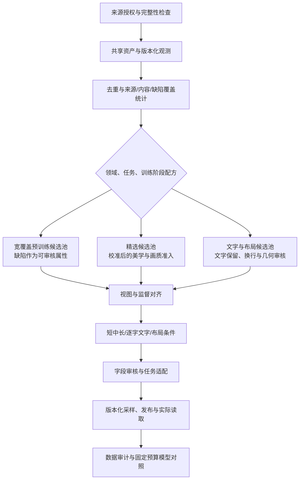

# 研究依据与工程映射

基础资料核查日期：2026-10-15；2026-10-18追加MOSS-Image技术报告分析，其他资料不因此视为重新核查。本文是选定公开资料的工程分析，不宣称覆盖所有最新版本。论文按完整技术报告阅读，重点评估数据流程可复现性；不做投稿接收判断。公开方法、工程推断和未公开信息分别标记。

| 资料 | 公开依据 | 本项目工程推断 | 边界 |
|---|---|---|---|
| [LLaDA-Image §3–4、附录D](https://arxiv.org/html/2609.03796) | 纯图像阶段先于图文SFT；条件来自实际图像；分字段caption审核，编辑指令核对方向 | 素材与标注分离，视图绑定监督，字段重做，image-only兼容检查 | 模型结构须支持相应条件机制；论文阈值需校准 |
| [LLaDA 官方仓库](https://github.com/inclusionAI/LLaDA-Image) | 训练代码仍标 coming soon | 按行为契约重新实现可恢复流水线 | 推理代码不等于完整数据流水线 |
| [Qwen-Image-2.0 §2](https://arxiv.org/html/2605.10730) | 通用/文字/知识/结构化描述，分阶段处理及错误驱动数据反馈 | 任务化标注与审核、错误taxonomy、补数版本对照 | 不能把前代报告直接写成2.1配方 |
| [Qwen-Image-2.1 官方说明](https://qwen.ai/blog?id=qwen-image-2.1) | 统一生成编辑、原生透明图、最多十张参考图 | alpha、图像角色和输入顺序成为契约字段 | 能力说明不是完整数据集或训练混合比例 |
| [Krea 2 技术报告 Data / Data infrastructure](https://www.krea.ai/blog/krea-2-technical-report) | 强调多样性；OCR辅助caption；分阶段去重与筛选；元数据和对象引用分离、持久状态驱动处理 | 保留独立分数、覆盖审计、算子成本分层、持久任务 | 不照搬其规模，也不把美学分作为所有领域统一门槛 |
| [Krea 模型卡](https://huggingface.co/krea/Krea-2-Raw) | 整体训练数据包含合成数据 | 真实/合成/未知及阶段分别追踪 | 报告中的无合成图限定预训练，不能扩大到全部后训练 |
| [FLUX klein 官方风格指南](https://docs.bfl.ai/flux_2/flux2_klein_training_example) | 特定风格LoRA示例采用内容caption、触发词和省略风格描述 | 基础标注保留完整，导出时按目标投影 | 教程示例不能替代通用预训练配方 |
| [BFL Base 微调说明](https://help.bfl.ai/articles/7108141705-can-i-run-or-fine-tune-flux-2-klein-locally) | 推荐未蒸馏Base作为微调起点 | target checkpoint是配方兼容条件 | 不能推断完整基础模型数据来源与规模 |
| [MOSS-Image §3、附录B/C/G/H](https://github.com/OpenMOSS/MOSS-Image/blob/c1355e6b1986dfe8fba3c0455783a05899212342/paper/MOSS_Image_Technical_Report.pdf) | 来源预处理后去重与AI图检测；宽保留语料并标注缺陷；多粒度caption、逐字文字和结构化布局；额外过滤有早期消融 | 评分与淘汰分离，宽覆盖与高质量配方并存，保留换行并绑定视图几何，评价区分文字覆盖、布局与人工偏好 | 额外过滤消融未单独测试ArtiMuse/DeQA；“无额外过滤”不代表无来源预处理；阶段表存在版本不一致 |

## 参考阈值如何处理

LLaDA 报告的像素数大于1024²、文件大小/像素至少0.15 byte/pixel、ArtiMuse≥60、DeQA≥4.0，仅作为待验证参考。[依据](https://arxiv.org/html/2609.03796)

实施时先保留连续分数与来源分布，在人工审计集测量误删，再按领域和阶段选择阈值。文件字节/像素受编码格式影响；截图、设计图、透明素材与摄影图应分别检查。未加载对应模型且未复核分数量纲时，不启用数值阈值。

MOSS-Image补充了另一种预训练选择：在来源预处理、去重和AI图检测后宽保留语料，用标注描述模糊、水印、压缩伪影等属性。其早期实验显示一组联合启发式过滤会损伤文字能力。因此，美学与画质应成为独立、版本化的评价模块，是否作为准入门槛由领域、任务和阶段配方决定。LLaDA式精选与MOSS式宽保留可以基于共享资产形成不同发布；二者都不能绕过来源授权、隐私治理和完整性要求。以下给出证据与限制。

## MOSS-Image 数据工程分析

### 阅读范围与版本

- 资料为官方仓库的《MOSS-Image Technical Report》，按完整技术报告进行数据工程审读。
- 读取官方35页PDF的正文及附录，渲染核对图3、表1及附录B的过滤实验；仓库版本固定为`c1355e6b1986dfe8fba3c0455783a05899212342`。[官方报告](https://github.com/OpenMOSS/MOSS-Image/blob/c1355e6b1986dfe8fba3c0455783a05899212342/paper/MOSS_Image_Technical_Report.pdf)
- PDF为32,234,760字节，SHA-256为`e33d75f5e2694901d6a320eedfa803425f51949c7f19fb3e70481b43a4552071`；Git blob为`0732a2c8e9f0f6279470eac7cfbb38d3541e9247`，与官方树一致。PDF和阅读缓存位于Git忽略的`.tools/papers/`，不提交二进制文档。
- 本节为新增分析和实施建议，没有新增评分模型、自动标注或训练代码；当前完成任务仍为20/70，实际实现见[实施状态](implementation-status.md)。

### 研究目标与方法

报告针对长文字和复杂布局生成，将问题分成“渲染指定内容”和“从简短请求规划内容及排版”。系统由5B DiT与推理时的提示增强模块组成；冻结文本编码器为Qwen3.5-9B，VAE来自FLUX.2。5B指生成骨干，不包含冻结编码器和VAE。数据工程重点是宽覆盖语料、多粒度文字监督、局部元素与布局，以及分辨率和文本长度课程。[§1–3、附录A](https://github.com/OpenMOSS/MOSS-Image/blob/c1355e6b1986dfe8fba3c0455783a05899212342/paper/MOSS_Image_Technical_Report.pdf)

提示增强在推理时做任务路由、资料检索和布局规划，不能直接算作训练数据已经标注或审核。正文§8明确当前骨干没有原图条件输入与图像编辑能力；修改布局后重新生成的例子，不等于保真编辑三元组。预留reference轴也不表示当前已支持多参考训练。

### 语料构建与筛选证据

**公开事实：** §3.1与附录B列出16项公开来源，包括ReLAION、OmniCorpus、DataComp等。来源构建预处理后，执行SSCD去重和内部AI图检测，并保留原来源比例。图3概括约5.5B来源记录得到约3.2B记录；按表8已四舍五入的逐行数相加，分别为约5.533B与3.235B。表8统计的是流水线接收/输出的来源级记录，不能当作原网站爬取规模、可下载授权图集或本项目独立资产数。

“无额外过滤”限定于上述后续语料准备阶段，报告明确保留来源构建时已有的检查，例如ReLAION的NSFW与水印检查。残余水印、模糊人脸和压缩缺陷会进入文字监督。它没有声明直接保留所有原始网络图片，也没有以图像检测器证明来源、授权或真人身份。

附录B.2使用早期模型，比较去重、重标后的ReLAION基线与额外联合过滤；两条运行均训练1.6M步。附加规则包括宽高、长宽比、熵、亮度、饱和度、水印面积和natural score。论文保留约43.35%的来源记录，其最后检查点结果如下：

| 指标 | 基线 | 额外过滤 | 本次观察 |
|---|---:|---:|---|
| DPG-Bench，越高越好 | 82.420 | 82.411 | 接近 |
| GenEval，越高越好 | 0.6484 | 0.6244 | 下降 |
| OneIG总体，越高越好 | 0.4363 | 0.3482 | 下降 |
| OneIG文字子项，越高越好 | 0.5243 | 0.1180 | 明显下降 |
| FDR6-LAION，越低越好 | 2.4126 | 3.2184 | 变差，作者提示跨训练分布比较有局限 |

**证据边界：** 这是早期骨干上的一组联合过滤对照，每条曲线一条运行，32个检查点不等于32个独立随机种子。它没有逐项隔离阈值效应，过滤后数据量与分布也发生变化；不支持把结果归因于某一条规则。实验没有单独检验ArtiMuse或DeQA，natural score也不能直接替换为ArtiMuse分数。报告对部分NULL字段放行的做法属于该实验规则，本项目仍要求缺失观测显式处理，不能静默当作成功。[附录B.2，PDF第16–18页](https://github.com/OpenMOSS/MOSS-Image/blob/c1355e6b1986dfe8fba3c0455783a05899212342/paper/MOSS_Image_Technical_Report.pdf)

**工程建议：** 保留美学、画质、文字密度、缺陷、来源等独立观测。宽覆盖预训练配方可以将部分缺陷作为监督属性，精选配方可以启用经校准的美学/画质门槛；两条路径都输出领域分布和误删审计。未入选是当前配方决策，不删除原始资产，也不写成全局bad标签。属性必须有可追溯检测或审核依据，不能自动给所有低分图拼接“模糊”描述。

### 多粒度caption、文字与布局

| 报告中的公开方法 | 对本项目的工程建议 | 当前状态与边界 |
|---|---|---|
| gemma4生成短、中、长描述；中描述从长描述压缩；生成参考图像、原始caption与描述视角 | 保留原始与生成变体、producer/模型/模板版本、视图摘要；核对来源文字是否引入新事实 | 对应6.2/6.3，尚未接入自动provider；文本改写成功不代表视觉事实正确 |
| 同时有原始与生成描述时，普通caption分支按20:80抽样；生成变体在有效非空项中均匀选择 | 在配方中冻结概率和缺失回退，并记录实际采样分布 | 不是全部图片或layout分支的统一比例，也不是本项目默认值 |
| 保留可见文字的原语言、换行、阅读顺序与排版信息 | 将逐字文本、行结构、OCR证据、几何和通用描述分开；基础标注不以空格折叠换行 | 对应6.1/6.4；评测专用文本归一化不得覆盖训练原文 |
| scene/element与summary/items两类布局，包含局部对象、文字、bbox及属性 | 增加版本化布局适配器，绑定画布、坐标顺序、单位、原点与视图 | 现有文字polygon契约不等于完整对象布局契约；当前sidecar适配器不支持layout条件 |
| 裁剪、缩放、翻转同步变换bbox，删除完全裁掉或退化的元素 | 在导出视图上验证坐标和监督；全局描述若仍引用被裁主体，转重标或复审 | 对应7.2；只删除局部框不足以证明全局描述仍忠实 |
| 对可选字段做dropout、重排，输出不同坐标表示 | 保存完整基础标注，按目标适配器和seed派生条件；保留语义有序字段 | 对应7.3/7.5；不能把随机重排推广到阅读顺序或多参考输入顺序 |
| JSON、必需字段、整数框、范围、正面积、ID与父引用校验；无效结果有限重试 | 先结构校验，再独立做事实、文字和关系审核，错误有界重试 | 结构检查不代替LLaDA式caption忠实度审核 |

附录B说明训练caption以英文为主，未专门标注中文caption；这与图内可见文字保留原语言是两个不同维度。本项目应分别记录描述语言和逐字文字语言，不能由该结果推断任意领域都不需要中文标注。

附录C.1抽查5,792张图片，其中4,335张具有完整三变体；Qwen3.5-9B tokenizer测得短/中/长均值约20.86/76.61/235.12 tokens。这是抽样分布，不是固定生成长度。报告的4096限制针对拼接字段并套用chat template后的完整条件，不能只数基础caption。论文允许截断；本项目对关键文字位于尾部的样本应保留溢出标记并重写或拒收，避免静默丢失监督。

布局基础框使用归一化`[0,1000]`、顺序`yxyx`；部分训练分支还使用绝对像素与中心相对像素。中心相对坐标需先完成视图几何，再减去对应画布宽高的一半。不能将原始坐标不加转换地传给当前使用`[0,1]`归一化polygon的契约。报告的坐标混合概率属于特定分支，当前不直接复制为默认配方。[附录C，PDF第18–20页](https://github.com/OpenMOSS/MOSS-Image/blob/c1355e6b1986dfe8fba3c0455783a05899212342/paper/MOSS_Image_Technical_Report.pdf)

### 评价结论及不能混淆的指标

- LLTB含240项任务，分中英与三个长度档；报告Mean-6为96.3。它采用OCR匹配单元的多重集召回，英文按词、中文按字；不检查顺序，也不直接惩罚多余文字，不能称为96.3%的逐字准确率。每任务四张结果都计分，没有best-of-four。本项目应另记录编辑距离、行顺序、额外文本与位置一致性。
- 7Bench的`mIoU_det=0.8786`只统计有正重叠检测的对象；全部576对象的`mIoU=0.6788`，检测覆盖445/576。导入比较结果时必须同时保存分母、未检出与过滤输出的处理，不能用已检出子集分数代替全量表现。
- RLA用61项海报、信息图和UI任务做人工盲比，固定输出、不重采样，左右随机；各比较组分别拟合Bradley–Terry评级。不同组的Elo不能直接相减当作提示改写收益；同任务/同审核者票的相关性也未纳入其区间校正。
- 附录H的自动rubric包含主题、布局、文字、连贯性、美学和渲染完整性，权重为30/20/15/10/20/5。这里的美学是**生成结果评价**，不是原始训练集的ArtiMuse筛选阈值。GPT-6同时参与规划与自动评审，报告将人工偏好作为主要排名证据；本项目同样需要独立人工基准，不能只靠生成模型自评。
- 文本换行和中心相对坐标的效果主要由定性案例支持，不能据此宣称本项目已验证普遍提升。推理时检索图只辅助规划，没有直接输入当前DiT。[§5–6、§8、附录G/H/J/K](https://github.com/OpenMOSS/MOSS-Image/blob/c1355e6b1986dfe8fba3c0455783a05899212342/paper/MOSS_Image_Technical_Report.pdf)

### 数字核对、公开缺口与可复现性

1. 表8逐行相加与图3的5.5B→3.2B近似规模一致；输入/保留均为来源级四舍五入记录，不能推算本项目的全局独立资产数。过滤实验`513,110,382 / 1,183,622,445 ≈ 43.35%`也一致。
2. 表4六组展示分数的均值约96.27，四舍五入为96.3；32个检查点、任务四次采样与独立实验种子是不同计数。
3. **训练日程存在未解释的不一致：** PDF第6页表1列四阶段，第3阶段370K步、第4阶段520K步且面积上限约`2×1024²`；同页正文仍写三阶段。图3、附录A.2及表6则指向第3阶段310K与`1024²`面积上限。渲染已确认这些内容真实存在，不能归因于文本提取。分析保留差异，待作者版本澄清后再冻结阶段/步数；不自行把第4阶段解释为SFT。
4. 该仓库快照包含报告、推理/ComfyUI、用户指南和提示增强工具，未见完整的SSCD索引构建、AI图检测器、训练清洗/重标流水线和预训练执行器。SSCD阈值、内部AI检测器校准、逐来源授权台账、精选layout子集的完整选样规则，以及布局分支的全局混合比例仍不足以从公开资料精确重建。
5. 论文没有提供可直接移植的ArtiMuse/DeQA权重与门槛配方；不得补写为“MOSS也使用与LLaDA相同的美学过滤”。512设备的训练配置也不构成本机或95的容量、成本与吞吐承诺。[官方仓库快照](https://github.com/OpenMOSS/MOSS-Image/tree/c1355e6b1986dfe8fba3c0455783a05899212342)

### 与LLaDA及当前框架的合并建议

以下是工程建议，尚未实施的新能力仍须通过OpenSpec任务与真实验证；本节没有修改已完成任务的验收范围。

- 美学/画质模型作为独立provider建设，评分、执行状态、模型/预处理摘要与配方决策分开。LLaDA参考阈值只用于经校准的目标分支；MOSS经验用于检验宽覆盖和长尾保留。两类能力均未因写入本节而实现。
- 多粒度标注、原文换行和布局适配分别对应6.1–6.4、7.2–7.5；先复用旧ImageCaption的输入身份、OCR与推理适配经验，再新增字段和独立审核。旧水印专用prompt与直接复用原图scene的裁剪路径需要专项修订，不能默认适用于MOSS式宽保留。
- 覆盖报告、固定预算消融与指标导入分别对应5.5、10.1–10.3、11.3。先对同一来源快照比较宽保留与精选配方，再比较单caption与多粒度、是否保留换行和布局条件；报告唯一资产、实际样本次、预算及失败项。
- 原图缺陷标注、多种caption/布局条件和监督类型相互独立；宽保留策略不能让普通T2I以空caption绕过契约，也不能把不支持布局或image-only的适配器标为兼容。当前最小发布仍仅支持已声明的T2I sidecar。

## 初始校准实验

1. 同预算比较全局美学门槛与分领域门槛，检查风格与长尾覆盖。
2. 比较全图caption直接复用与视图级重标，检查裁切错误和文字错误。
3. 比较单长caption与短中长混合，固定token预算并检查真实短提示表现。
4. 比较感知去重与加入语义候选复审，检查有效变体损失。
5. 比较全量大VLM处理与廉价路由后专项处理，报告人工一致性和每万张成本。
6. 编辑数据检查方向和非目标区域保持；生成质量好不代表编辑监督正确。

以上都是拟议实验，目前无本项目实测收益。数据量、模型效果或成本结论必须引用实际版本与报告。

## OpenSpec 使用依据

采用[官方 OpenSpec](https://github.com/Fission-AI/OpenSpec)的 proposal → specs → design → tasks → apply → archive 流程。本仓库固定CLI版本1.14.2。当前规划已完成并持续实施，最新任务证据见[实施状态](implementation-status.md)与[tasks](../openspec/changes/design-image-data-framework/tasks.md)；语法校验成功不等同于系统功能测试成功。
