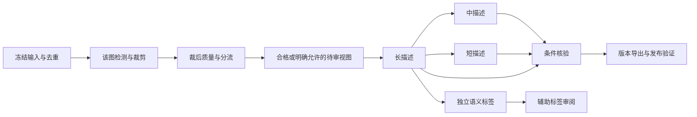

# Togeari 执行层评估（2026-10-24）

## 结论与核查边界

建议借鉴有界并行、兼容请求合批、worker 池和分段计时；先做可回退的执行器试点，再决定是否引入 Togeari 依赖。当前没有安装或集成它，也没有新增 GPU 吞吐证据。已有版本管理、裁剪、质量分流、三档描述、标签契约与发布验证继续由 ImageCaption 负责。

本次核对官方仓库提交 [c03eb960](https://github.com/KohakuBlueleaf/Togeari/commit/c03eb96036d7f6559866b9d010d1363de2ea314d)。它将 KIR 表达的单任务程序调度到可插拔引擎，一个 Machine 是单进程调度器；它没有提供本项目需要的标签模型、长中短描述模板或图像质量阈值。[项目说明](https://github.com/KohakuBlueleaf/Togeari/blob/c03eb96036d7f6559866b9d010d1363de2ea314d/README.md)

本评估只读公开代码和本地程序代码，没有读取真实图片、描述或 OCR。以下接入方式均为工程建议。

## 与现有实现的对应

ImageCaption 的 `backend/curation/workbench_pipeline.py::Execution.run_stage()` 当前逐行调用，阶段间顺序推进。`workbench_providers.py::Providers` 管理一个常驻 command 子进程，已支持同模型兼容参数复用，但不是多 GPU 池；DeQA 有独立实验性 batch 协议，主 build 尚未普遍合批。`STAGES` 已声明长描述是中、短描述和标签的共同父依赖。

| 策略 | 接入位置与预期价值 | 实施条件 |
|---|---|---|
| 同阶段有界并行 | 在 `run_stage` 内允许多个独立样本在途，先保留阶段屏障，减少迁移范围 | 不共享可变 row；结果返回后由单一提交者校验身份、写缓存及 Journal |
| 按兼容性分桶合批 | 每个模型队列按数量或等待时间触发；优先试验已有明确输出拆分协议的模块 | key 至少包含模型修订、精度、预处理规格、任务类型、生成参数；图像 token / 文本长度按预算分桶 |
| 常驻 GPU worker 池 | 单卡一个模型副本或明确的阶段 worker，降低重复加载并提高供给 | 每卡独立显存预算、进程健康、允许使用的 GPU UUID；池不能绕过已有占卡守卫 |
| 逐视图依赖调度 | 该图长描述完成即可排中、短及标签，无须等其他图长描述全部结束 | 长描述失败不得派发依赖；仍绑定实际裁后视图与同一父标注，不重新描述原图 |
| 队列反压 | 限制在途图像数、解码字节、预计图像与文本 token | 下游堵塞时暂停接入；不能把容量估计当作 OOM 保证 |
| 执行时间分解 | 看板显示排队、加载、预处理、推理、写入及同步时间 | 以实际完成的唯一视图或变体为分母，缓存命中与真实推理分开 |

这些机制对应 Togeari 的 [分桶/发批策略](https://github.com/KohakuBlueleaf/Togeari/blob/c03eb96036d7f6559866b9d010d1363de2ea314d/src/togeari/core/policies/former.py)、[资源预算](https://github.com/KohakuBlueleaf/Togeari/blob/c03eb96036d7f6559866b9d010d1363de2ea314d/docs/guides/resource-budgets.md) 与 [调优和指标说明](https://github.com/KohakuBlueleaf/Togeari/blob/c03eb96036d7f6559866b9d010d1363de2ea314d/docs/guides/tuning.md)。我们是否得到收益取决于实际模型 batch 能力、磁盘与 CPU 供给，不能从框架功能推出速度提升。

## 对标签与长中短描述的影响

Togeari 可改善请求组织，不改变语义提取质量。现有标签继续使用独立词表版本、JSON 校验、来源证据、unknown/unsupported 和待审状态；不会因为调度成功就自动变成训练条件。

建议的依赖关系如下；这是目标调度示意，不是当前实现声明：

全局去重、样本划分、冻结成员和发布验收保留明确屏障。对水印过阈值的样本仍按现有辅助候选/待审策略处理；队列优化不得直接丢弃它们。中短描述可以各自从 long 生成，不应串成 long→medium→short 叠加信息损失。

首轮只优化阶段内部，第二轮才评估逐视图流水线。这样能先验证身份、缓存与恢复，而不同时重写整个数据依赖图。

## 需要保留的边界

1. **批处理等价性。** 引擎 B6 约束要求单项结果不受同批其他项影响。生成模型要核对逐样本 seed、padding、停止条件、截断和结果拆分；随机推理不能仅凭相同请求宣称确定性。纯函数可精确回放，生成文本需固定可重放结果或另设语义与分布验收。[引擎契约](https://github.com/KohakuBlueleaf/Togeari/blob/c03eb96036d7f6559866b9d010d1363de2ea314d/src/togeari/core/contracts/engine.py)
2. **错误分层。** 坏输入是样本错误；模型崩溃、超时和 OOM 是执行问题。执行失败不能变成低美学分或数据质量拒绝。重试、迟到响应和 worker 替换需绑定 attempt/result identity，不能重复计入已完成量。
3. **版本身份与业务提交。** Togeari 的实现/绑定 revision 是声明，不会替我们验证模型文件。继续实际核对 code/model/template/config 摘要；保留 CAS、Journal/outbox、审核和发布。调度器调用顺序正确不等于外部写入 exactly-once，跨 job 的共享输出必须由现有幂等提交处理。[身份声明](https://github.com/KohakuBlueleaf/Togeari/blob/c03eb96036d7f6559866b9d010d1363de2ea314d/docs/guides/execution-identity.md)、[一致性回放](https://github.com/KohakuBlueleaf/Togeari/blob/c03eb96036d7f6559866b9d010d1363de2ea314d/docs/guides/conformance.md)
4. **四卡适配。** 优先比较独立副本和按阶段分配，不能假定四张 32GB 是一块 128GB。内置 TorchModule 的自动切分面向 `nn.Sequential`；JoyCaption 一类模型需要自定义加载、输入打包、forward 与结果拆分，或复用已有推理服务。[模型适配代码](https://github.com/KohakuBlueleaf/Togeari/blob/c03eb96036d7f6559866b9d010d1363de2ea314d/src/togeari/engines/torch/model.py)
5. **调试数据。** Recorder 会持久化完整采样输入与结果，不能直接并入公共诊断包，也不能替代业务审计。完整回放先限合成数据；真实测试只汇总身份、时间、计数和错误码，实际内容留在用户控制的本地目录。[Recorder 代码](https://github.com/KohakuBlueleaf/Togeari/blob/c03eb96036d7f6559866b9d010d1363de2ea314d/src/togeari/plugins/record/recorder.py)

许可证为 [Apache-2.0](https://github.com/KohakuBlueleaf/Togeari/blob/c03eb96036d7f6559866b9d010d1363de2ea314d/LICENSE)；复制代码或引入依赖时保留适用声明。外部模型许可另行处理。

## 试点与取舍建议

先增加可选执行器适配边界，默认仍用现有串行路径。具体参数名与协议需另立 OpenSpec change，本文不宣布已有 `--executor` 等命令。

| 对照 | 要回答的问题 |
|---|---|
| A：当前串行 | 冷启动、热运行、缓存重放分别花在哪些环节？ |
| B：现有业务函数 + 轻量有界 worker 池 | 仅减少空闲和重复加载是否已足够？ |
| C：相同业务函数 + Togeari 适配 | 相对 B 是否降低维护复杂度，或改善长尾、故障恢复与吞吐？ |
| B/C：单卡 batch 与四卡副本 | 实际算力与供给瓶颈在哪里，增加 GPU 是否仍有收益？ |

首先用合成样本验证序列/并发结果身份一致、乱序回包、重复回包、坏样本、OOM、退出与恢复。之后在同一冻结清单上做用户已授权的真实形式测速，只读取汇总指标；不查看内容。建议预热后轮换顺序测至少三轮，同时报告冷启动，不能把 warm cache 结果与全量推理比较。

记录 images/s、caption variants/s、tag prompts/s、p50/p95 延迟、排队/加载/推理/写入时间、峰值 RAM/VRAM、实际 batch 分布、失败/重试率和缓存命中率。保持 crop、美学、DeQA、文件密度阈值、描述生成参数及模型版本一致。质量是否等价另由用户审核；并发结构测试不能证明语义质量。

采用条件应是：所有身份/恢复契约通过、没有新增静默丢失或重复提交、资源有余量，且实际收益超过重复测量的波动。收益不足时保留轻量方案。官方约 1.9–5.1× 的数字来自 Rust/Python 调度器比较，包含即时模拟引擎；不能转换为本系统或四张 5090 的加速承诺。[性能方法](https://github.com/KohakuBlueleaf/Togeari/blob/c03eb96036d7f6559866b9d010d1363de2ea314d/docs/performance/native.md)
