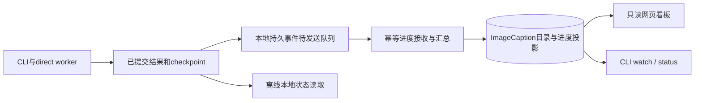
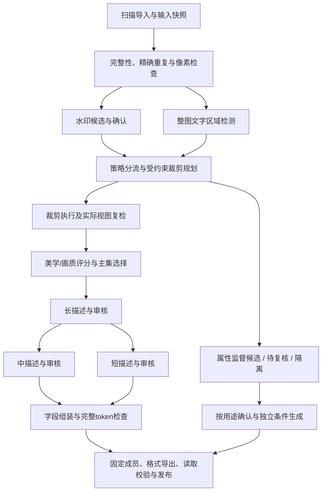

# Design

## Context

动机与交付范围见[proposal](proposal.md)。本change以ImageCaption的实际CLI使用方式为依据，规划保存在DataPipeline，运行时代码目标为ImageCaption。旧通用底座的21/70项完成记录保持独立，不能直接折算为本change进度。

已核对的工程入口及观察：

| 入口 | 观察 | 本设计落点 |
|---|---|---|
| ImageCaption GitHub快照`9e90b53037e466e91c0a64ab4fbac09be857a361` | 已有FastAPI、PostgreSQL、React、CLI/worker、direct batch和可验证导出 | 扩展现有产品，保留旧接口和策略 |
| `backend/curation/progress.py`、`frontend/src/RunProgress.tsx` | 按数据库任务聚合，非图片阶段主要统计操作次数；阶段明细默认折叠 | 增加内部工作量、默认阶段卡片和direct CLI上报 |
| `frontend/src/RunActivity.tsx` | 部分变化记录依赖浏览器会话，不能充当持久运行历史 | 服务端持久事件，浏览器只读投影 |
| `tools/keyword_extractor/` | 有长描述压缩为短描述的独立工具 | 纳管并补齐中描述、字段状态和统一版本 |
| node95部署与批次自带脚本 | 部署HEAD为`11c6fcfd3726add321aef40c42716e04f363a8e5`；实际批次有独立裁剪脚本，不能只按GitHub入口推断运行方式 | 实施固定目标代码及脚本摘要，增设历史/新协议适配 |
| 最近批次的只读几何核查 | 先选最大面积再检尺寸会遗漏其他可行矩形；候选框确认不足；没有整图文字面积门控 | 联合约束搜索、候选确认、文字检测与分流 |

上述批次核查未查看图片、真实caption或OCR内容；几何可行性不构成误检率或视觉质量结论。真实路径、逐图记录和批次统计不写入本仓库。MOSS的多粒度与属性条件证据见[研究依据](../../../docs/research-evidence.md)，本设计不宣称复刻其未公开训练流水线。

## Goals / Non-Goals

**Goals:**

- CLI启动后，终端和网页都能看到阶段、内部工作量、结果分布及等待原因；看板不参与模型执行。
- 主照片集保留用户要求的水印裁剪与大面积文字过滤，辅助属性用途有独立准入和条件。
- 同一原图、不同视图、不同标注和多次运行通过稳定身份管理；增加版本不重复复制全部数据。
- 新增功能按阶段接入，能够在质量模型接入前交付版本骨架与真实进度看板。
- 在未完成真实质量校准时仍可交付可追溯的初代审阅结果，由用户检查实际视图和描述；审阅交付与训练发布分别记录。

**Non-Goals:**

- 首版不重建完整网页操作台、不增加公开无认证服务，不要求从网页启动批处理。
- 不将全部holdout作为负样本，不自动构造原图/裁剪图偏好对，也不新增模型训练器。
- 不覆盖或修改历史图片与已有生产输出；已获授权的部署与小批试点使用独立目录，不把旧批次完成标记或审阅包当作完整训练发布验收。

## Decisions

### 1. CLI执行与只读看板共用状态

沿用ImageCaption的CLI、控制API和PostgreSQL。direct执行器增加版本化事件适配；本地批处理继续写已验证结果和checkpoint，进度事件是这些提交事实的索引。数据库保存目录、运行登记和已接收的进度投影，网页不通过扫描大目录或解释任意stdout推断成功。



网络不可用时将事件留在本地待发送队列；本地watch显示本地来源，远端看板显示最后同步时间和过期标记。恢复后幂等补报，不补造断线期间的心跳。现有API鉴权和默认本地监听继续使用，远端浏览优先通过已有安全连接方式访问。

相比全程解析日志，此方式能确定工作身份和提交边界；相比再部署一套调度系统，直接复用现有控制面。原始日志保留为故障材料，不能成为唯一计数来源。

### 2. 数据版本、运行和产物身份

新增产品级数据集及版本目录，与既有batches、runs、assets、occurrences、derived_assets、exports建立映射。通过增量迁移接入旧数据库，不直接创建另一套同名资产表。

| 身份 | 固定内容 |
|---|---|
| dataset_id | 长期数据集与来源关联 |
| dataset_version | 人类可读`v0001`等序号、内部ID、父版本、构建意图及变更说明 |
| run_id / attempt_id | 一次冻结构建与其重试尝试；重试不递增数据版本 |
| view_id | 原始身份、变换配置、实际输出SHA与几何 |
| observation / annotation | 视图、模型、模板、配置、状态、父结果和审核引用 |
| export_id | 固定数据版本、格式、caption模式、产物校验 |

版本在计划创建时事务预留，允许序号有失败记录或空缺但不复用。状态为draft、building、validating、ready、failed、withdrawn；明确区分`image-prepared`与`training-dataset`产物类型。版本内容改变产生新版本；仅重新打包产生新导出。每个版本包含主集、辅助候选、待复核和隔离清单及相互对应关系。

物理对象按内容摘要复用。只读引用可用于内部消费，可移植导出按需复制/分片；可变源文件不能直接作为可信不可变对象。旧硬链接产物纳管时记录来源与可变性，未重验实际输出摘要不提升为新协议的已验证版本。主集和辅助原图共享亲缘组，切分时防止跨训练/验证泄漏。

### 3. 阶段图与失效范围



此图是目标阶段图，分支可以并行；看板不能把它降为只有一个活动步骤的固定线性进度条。旧策略仍有原阶段序列，新流程按冻结策略声明启用/跳过节点。未选辅助训练时，辅助候选保留为目录产物，不阻塞主集发布；但主集本身必需审核或失败未解决时不得ready。

缓存键包含输入视图、算子、模型/权重、模板和配置。阈值变化重做决策；水印确认变化重做相关规划/视图；视图变化使相关评分和标注失效；摘要模板变化只重做该变体及其条件组装。人工改判保留旧事件；若重新打开已终结工作，显式记录新的阶段代次，不能偷偷重置进度。

### 4. 水印裁剪与文字门控

检测召回阈值和确认/自动处理门槛分别配置，保留每个候选框的完整置信与坐标证据。低置信、异常全图框和不稳定结果进入复核；OCR是辅助证据，空OCR不否定图形水印。新自动处理门槛经审核集校准后冻结，不能照搬旧候选阈值。

裁剪规划先建立确认框及安全边距，在可行集合中同时约束尺寸、保留面积、允许区域和格式；再按保留面积及确定性规则排序。输出记录计划矩形和实际矩形。JPEG系数裁剪对齐失败时，仅采用策略允许且满足约束的替代格式；全流程保存实际输出摘要。几何无交叉、残余水印复检和主体/监督一致性是不同检查。

文字检测覆盖整图，至少记录`text_union_area_ratio`与`largest_text_block_ratio`。坐标先按实际画布裁边，重叠区域只算一次；局部分组使用固定规则，不能用全局文字外接框吞并大片空白。大文字主集过滤先在原图执行，裁后再重算或复检。检测失败、无文字、异常框分别表达；阈值为待校准参数，不预置假定有效的百分比。

### 5. 质量分级、辅助用途与三档描述

像素、技术画质、美学分别保存；原图和视图观测不能混用。实际训练视图完成后再做精细评分，可在前面用廉价观测路由。按领域和用途冻结分类、门槛与人工覆盖；高像素不自动等于高美学。

文件密度观测绑定原始source SHA，使用原始编码文件实际字节数除以解码后的宽×高，单位为byte/pixel，不是bit/pixel。`pixels.min_bytes_per_pixel`为有限非负数，参考配方为0.15，等于门槛合格；省略或null保持旧配方不启用。CLI build/dry-run的`--min-bytes-per-pixel`覆盖配方，`--no-byte-pixel-gate`显式关闭，两者互斥。动态调整指新版本或dry-run使用新参数，不改变已冻结运行。门控在既有selection阶段与其他质量规则共同执行，原始观测独立于门槛，可复用；不承诺提前跳过评分推理。

裁后输出字节不能替代原始观测，转PNG或增加编码体积不能让同一原始样本绕过门槛。低于门槛或缺少可信原始观测不进入主集；仅低文件密度不构成水印等辅助属性，已有辅助候选也不能凭该状态通过辅助训练准入。保留原图、比值、格式和原因码，dry-run报告阈值、分布、未知数及可能涉及的后续生成阶段。编码格式、元数据、图像复杂度均会影响该比值，它是用户选定的启发式门控，不是质量评分或已验证的通用压缩伪影检测器。

辅助审核证据与最终准入决定分开保存。降低门槛后，预览同时检查主集新入选和已审辅助候选恢复准入的描述补算；旧清单缺少审核时明确待审核，不能仅凭门槛放宽宣称可训练。

prompt语义标签化先调研开放权重文本模型，比较结构化输出、中英抽取、NSFW中性分类的拒答与准确率证据、许可证及硬件需求。建议标签保留输入caption/variant摘要、模型/模板/词表版本及文本证据；不从短描述补造图像事实。当前请求先交付选型与评测建议，未部署或验证的标签器不得标为已集成。

`quality.aesthetic.enabled`与`quality.technical.enabled`是全局独立执行开关，必须为布尔值，省略时维持启用。CLI build/dry-run的`--[no-]aesthetic`、`--[no-]technical`覆盖配方后冻结；同一state改开关必须创建新版本。域配置可改变门槛，但不提供执行开关。`required:false`继续表示评分运行但不用于准入；`enabled:false`同时跳过模型身份读取、加载、推理与相应校准核验，观察记为disabled且score=null。执行开关不属于阈值校准参数摘要，旧未带开关的报告继续兼容。

关闭节点保留在阶段图中，冻结enabled=false及零工作量；本地/API/网页单独显示已关闭，不计为评分通过、缺模型或质量待复核，验收分母排除关闭节点。关闭不改变其他像素、水印、文字、描述及发布约束。dry-run分别统计关闭与未知，重新启用时将评分列入重算范围，不将旧disabled观察当成功分数。

每个样本有一个主路由和多个原因：主集、辅助候选、待复核、隔离。水印确认但无法合格裁剪的原图可进入属性候选；大文字是独立属性；仅尺寸不足不证明水印缺陷。辅助样本需要单独满足来源、画质、属性证据、条件和适配器要求。记录到名为negative的目录不构成训练监督，也不将原图/裁剪图直接充当同条件偏好对。

第一版复用长描述适配器，在实际视图上产生并审核长描述，扩展现有摘要器生成中/短描述。生成状态和事实审核独立，短中描述保留父标注。后续可对照一次生成三档的VLM，但不作为首版依赖。正常图中文字与水印等属性分开保存；旧水印专用模板保持历史兼容，新模板不无条件省略所有正常文字。

条件构建顺序为选择变体、投影/拼接属性、套目标模板、使用目标tokenizer检查完整长度，保存最终条件摘要。固定TXT导出只选择一档；随机混合需要实际训练器适配，不能默认把三档变成三倍图片。MOSS的比例和长度分布属于文献事实，不自动成为默认配方。

### 6. 进度契约和恢复

事件至少带`schema_version / dataset_version / run_id / stage_id / stage_generation / substep_id / partition_id / attempt_id / seq / emitted_at / unit / total_known / total / result_checkpoint_ref`。传输事件可重发，服务端记录接收时间；本地或远端聚合器均从同一结果身份和checkpoint口径恢复计数。

每个分片尝试写独立产物；协调器固定当前有效尝试代次。已提交、已验证的工作ID才可进入计数。重复事件和旧序号不增加数量，过期尝试不替换当前投影；校正或人工重新打开结果保留原因及代次。不能对多个worker的历史累积数简单相加。对direct模式采用单分片单有效写者，断线期间旧尝试只可写其隔离目录，恢复并校验后才能被接纳。

同一阶段当前主结果互斥，定义：

```text
resolved = passed + routed_out + review_pending + failed_final
total = resolved + running + retry_wait + pending
处理进度 = resolved / total                 # 只在total已知且大于0时显示
重试次数、附加原因数、已复用结果数            # 独立统计，不再次加入resolved
阶段验收 = 所需结果与审核满足该阶段的契约      # 不能由百分比推导
```

`passed`指该阶段通过，不等于训练发布通过；`routed_out`是正常分流，不是执行失败。`review_pending`已产生可审结果但未获准入；配置要求审核时阶段状态为waiting_review。仅某个辅助分支待复核不必阻塞无关联主集阶段。caption同时提供三个变体分母和“三档合格图片数”，避免父阶段重复累计同一张图片。

扫描阶段未知分母显示“已发现/已处理”；扫描结束冻结下一阶段输入。文件复制和校验计文件/字节，模型加载显示加载子步骤；无法测量内部进度时明确“不提供百分比”。没有合格输入时显示`empty_input`及路由结论。默认不生成全流程百分比，展示已验收阶段数、各活动阶段和关键阻塞。

速率建议使用最近60秒的新增已提交工作，冷启动、重连和暂停后先积累有效窗口；缓存复用瞬间的跳增不用于推理吞吐估算。ETA仅在已知总量和有效速率下估算并注明单位/窗口。心跳与最后有效进展分开记录，长耗时子步骤可以有心跳但无结果增量。首版建议5秒刷新、按阶段配置过期与无进展提示，实测后调整；这些是目标配置，不是已验证性能。

### 7. 看板与CLI交互

首版扩展现有React进度页与查询API，不新建独立前端项目。看板默认展示运行列表、阶段卡片和当前子步骤；详情展开分片/节点、结果原因和尝试记录。默认只显示匿名工程信息，无图片、caption或OCR预览。网页为只读，开始/暂停/恢复沿用CLI，避免引入第二套控制语义。

v0.3实际CLI能力（参数以ImageCaption帮助和手册为准）：

```text
ics workbench build --dataset ... --input ... --state ... --objects ... --policy ...
ics workbench import-legacy --dataset ... --manifest ... --state ...
ics workbench status --run-id <run-id> --json
ics workbench watch --state <state>
ics workbench diff <manifest-a> <manifest-b>
ics workbench dry-run --manifest ... --policy ...
ics workbench retry --state ...
ics workbench publish --state ... --output ... --config ...
```

页面示意，以下全部为合成数字，不表示任何真实批次正在运行：

```text
数据集 demo-images  |  v0002  |  run-demo-02  |  运行中
当前阶段：水印裁剪   子步骤：输出校验   数据更新：3秒前
已提交结果 18,240 / 24,000 张（76.0%）
通过 17,800  分流排除 300  待复核 120  最终失败 20
运行中 16  待处理 5,744  重试等待 0
速率：窗口不足，暂不可估计   ETA：待估计
阶段验收：未完成；复核/失败详情可查看
```

阶段卡片覆盖扫描、去重/像素、水印检测/确认、文字检测、裁剪规划/执行/复检、美学、长/中/短描述及审核、条件组装、打包/实际读取。多节点显示节点身份、当前阶段、最后心跳和各自分片，不将断联显示为持续可信运行。API提供快照修订号和有界事件游标，首版轮询即可；相比优先建设WebSocket，轮询更容易验证恢复与一致性。

旧进度接口由兼容适配提供原字段，不改变旧客户端含义；新字段使用新版本响应。旧direct历史批次通过只读导入显示已核实结果，并标识`legacy_snapshot`。对未改造且正在运行的旧脚本，只能报告可验证checkpoint和元数据来源，不能推算不存在的实时子步骤、速率或ETA。

### 8. 2026-10-23补充：可操作看板与推理复用

看板以“启动与登记→监测和排错→审核及交付”为操作路径，保留CLI执行边界。顶部显示当前活动、发布状态及下一步；阶段按输入准备、质量筛选、描述条件、导出交付组织，默认仍显示全部，可定位问题阶段。活动状态以执行状态和当前计数为依据，不因存在待复核结果而隐藏正在执行的工作；页面明确首次加载、无运行、同步过期、连接失败与历史快照。

排错按症状提供经CLI帮助核对的命令模板：先查本地status/watch与远端run状态；本地有进展而远端落后时sync；构建失败修复后retry并重新执行原build。打包发布失败则直接重跑原publish，重验文件并幂等补齐发布回执，不由build代替。repair-outbox仅用于从checkpoint重建事件队列，不恢复执行；reopen不自动重开所有依赖，不作为常规重试指引。模板路径为占位符且网页不执行命令。只读诊断导出采用白名单，仅含规范化阶段/状态、工程计数和时间，不导出任意错误文本、数据集名、路径、图片、caption、OCR或凭据。未知原因聚合为未知，不伪装已定位根因。

发布期间持续上报心跳，导出、登记及本地完成持久化异常记录package失败，保留有效逐项结果。服务端可能已成功登记而本地回执尚未落盘，应分别保留两侧事实并允许相同manifest/config幂等恢复；另一导出尝试失败不撤销旧ready版本或旧产物。

同一模型的长中短推理只有在worker协议明确支持每请求参数时，才允许共享驻留进程。启动身份仍包含权重、源码、精度、设备与其他初始化参数；每变体的模板、生成参数和结果缓存身份保持独立，不能为提速串用输出。以合成协议测试验证重载次数与请求参数，不以此宣称真实GPU吞吐提升。

论文和社区建议分别记录证据版本与适用范围。标签从已有prompt抽取时保留文本证据及否定/不确定状态，不能把未提及当作不存在；短中描述压缩采用事实覆盖与新增事实审核，不能仅用长度或词面重叠判断质量。多长度训练配比须由目标训练器和领域验证，不直接照搬论文。先测元数据存储、模型重载和请求批处理，再规划四卡资源分配；单卡速率乘四仍只是未经实测的容量假设。

### 9. 实施边界与验收顺序

2026-10-22的v0.3在完整ImageCaption checkout接通上述新CLI、资产/导出映射、视图缓存、阶段代次、质量处理、三档描述和参考加载器发布，见[v0.3记录](../../../docs/imagecaption-v0.3-status.md)。新build具有17阶段内部计数，通用direct的扫描、YOLO、OCR、prepare、JoyCaption与portable export已接入可选钩子，特定定制包装器仍须接入。版本ready禁止改变数据内容；同一冻结manifest更换导出配置，可仅重开package代次，保留先前导出及ready状态。

P0核对目标完整checkout的基线、API/表迁移和旧CLI兼容，创建版本/运行骨架与合成夹具。P1优先交付内部进度、终端watch和只读网页看板，接通现有处理阶段。P2完善水印确认/联合裁剪及整图文字过滤。P3接入美学和分流。P4纳管三档描述、最终条件和导出。P5做小批与恢复验收。

规划文件在DataPipeline同步；实施需在ImageCaption工作目录绑定这份规格及明确的代码基线，再执行apply。源仓库现有schema/sql、CLI解析器与direct脚本必须走兼容迁移，不能以本仓库的通用底座测试通过代替目标集成测试。历史脚本/数据只读纳管，不在生产目录试验覆盖。

### 10. 2026-10-23补充：待复核草稿与GPU 3初代审阅交付

`captions.review_candidates`缺省为false，只接受JSON布尔值，拒绝字符串、数字及null等隐式真假转换。它与caption启用状态分别冻结：只有caption功能启用、该开关为true且具有有效实际视图的review成员才增加三档草稿工作；开关不能重新启用已关闭caption。可解码、可读取且摘要匹配的既有视图可用于草稿；缺失/损坏文件、无效视图和未进入有效视图集合的重复或隔离项不因开关开启而获得生成资格。

新增草稿仍绑定source、view、模型、模板、参数、父标注及审核身份；中短分别引用同一父long。草稿成功只代表生成成功，不修改review路由、不自动批准已有审核、不通过主集或辅助训练准入。未完成的视觉/文本审核、未校准的裁剪/文字/评分门槛继续显示待审或待校准。父long失败时子摘要保持缺失/依赖阻断，不使用无关历史描述补齐。改变该开关需要新冻结版本，不能在旧state原地改变工作集合；未指定时保留原行为。

新增`workbench review-export`是独立审阅入口，目标是让用户检查初代结果，不要求先通过训练准入。包内保留运行/版本及配置身份、来源与实际视图对应关系、可检查的图像文件、三档描述或明确缺失状态、审核与路由状态、数值观测和原因、文件校验和、摘要统计及离线HTML。来源/视图和标注绑定须校验；使用引用或包内副本时明确其存储方式，图像字节保持原样，不能重编码后沿用旧SHA。原始文件和既有导出保持不变；输出路径不得覆盖源目录、构建状态或已发布训练包。

审阅包显式标识审阅用途及`training_ready=false`，不调用训练发布接口，不创建训练`release.json`或构建`publication.json`，不改变版本publication_state或训练package验收。允许包含待复核草稿和缺失变体，但不得把缺失描述补成空泛占位正文或伪造人工批准。生成/复制中断与完整性检查失败须留下可追踪失败信息，不能交付损坏包为完成；相同输入与配置恢复时重验字节，已存在目录身份不匹配则拒绝覆盖。

离线HTML仅用于用户在本地检查真实内容；将描述、原因及可见文字作为普通文本转义，不加载远端脚本、模型或资源，不将可控路径变成目录穿越或任意外部链接。审阅包与训练产物、诊断摘要是三个不同交付物：诊断摘要继续只含白名单工程信息；包含真实内容的审阅包留在仓库外，不通过聊天或Git展示。助手可检查包的文件数量、摘要、字段完整性、HTML静态结构及生成状态，不能渲染或读取真实语义内容；视觉与描述质量由用户检查。

node95试点先确认GPU 3的设备身份、显存和进程占用，记录检查时刻及必要显存预算；只向明确空闲的目标卡提交本轮作业。前置任务未结束、占用变化或余量不足时等待/延期并报告资源状态，不终止既有进程或静默改用其他卡。GPU索引和UUID均记录在仓库外试点配置，子进程以显式设备范围运行；开始前检查不等于全程独占保证，报告仍记录共享CPU/磁盘及其他卡负载。

从既有授权目录按固定seed与稳定文件身份选择32张，不依赖文件系统遍历顺序；冻结抽样算法、样本清单摘要、来源/视图SHA及代码/模型/配置身份。原始输入只读，state、对象、缓存、计时和审阅输出使用独立目录；运行前后重验输入字节。试点按阶段记录冷启动/身份校验、模型请求、持久化及总墙钟、成功/失败/复核与实际token等可获得计量；不可拆分的内部时间标为未知，不把恢复缓存命中算作新推理吞吐。

小批恢复复跑核对阶段计数不重复、原始字节及输出引用一致，并用相同样本对照美学/画质关闭与启用、文件密度门控开关及阈值变化。配置变化使用新版本或明确的dry-run；纯预览的路由差异和实际执行次数分别报告，不因关闭评分获得主集路由而宣称质量已校准。原有2.5的定制direct覆盖和6.4的真实质量审核条件不因32张形式试点、草稿齐全或用户收到审阅包而自动满足。

交付时记录两仓库的提交/远端同步状态、node95实际部署SHA、独立运行ID/版本、样本数、输入不变结果、模块时间、缺失项和审阅包位置；逐图路径、图像、caption、OCR、模型和凭据不入Git。先产出并核验可供用户检查的审阅包，再报告已完成范围及待校准项；不把首次小批性能外推为四卡速度或稳定生产能力。

## Risks / Trade-offs

### 追加：模块审核与性能证据

2026-10-22追加需求采用真实图片的数值/结构测试，不查看或展示像素、OCR或caption。性能记录分别保存输入清单摘要、抽样方法、尺寸/格式/字节分布、成功/失败数、首次请求、稳定请求p50/p95、实际墙钟吞吐、哈希/加载/解码/模型/持久化时间及资源采样。缓存命中和重试不能算成新推理速度；输出缺失或失败不能计入成功吞吐。共享机器不清空系统缓存、不终止其他任务。

当前`workbench build`为逐阶段逐图片执行，单执行器只驻留一个provider；四卡容量必须分别报告模块实测速率、按当前串行行为计算的服务需求、假设多个独立分片副本的容量上限和共享磁盘/CPU限制。拼合模块时间不能称完整运行实测。容量模型显式输入各阶段访问比例、caption token长度、checkpoint与缓存提交次数及固定启动时间；缺少caption实测时只能报告图像处理子链路，不能冒充完整图文生产速度。四卡实测需要实际空闲窗口；未测不标为已验收。

先修复审计暴露的字节重验、隐含大批次上限、异常评分/几何边界，再比较性能。优化不得省掉实际SHA校验、削弱恢复语义或改变未校准状态。稳定输入抽样、持久原始数值和可复现命令保存在仓库外；公开记录仅列脱敏聚合与限制。

元数据允许通过`storage.result_cache_root`及已有`--state`放在独立本地SSD，图像对象仍保留大容量盘。构建期间保留空闲SQLite连接以减少反复关闭WAL的收尾开销，每项结果仍独立FULL提交；必须验证进程中断后的重开恢复。性能测试将读取/模型请求时间与测速记录自身的落盘时间分开。

- [日志存在但没有真实提交] → checkpoint及结果身份校验，stdout和完成标记只作线索。
- [重试和重复上报使进度超过100%] → 工作集合、尝试代次、幂等事件和互斥主结果计数。
- [看板离线仍显示运行] → 源事件时间、接收时间、心跳和最后进展分开，明确过期状态。
- [整图文字误检造成过度排除] → 面积几何校验、低置信复核、领域校准和多原因记录。
- [裁剪几何合格但主体受损] → 视觉审核与视图监督匹配独立验收，不把纯几何计数当收益。
- [带印原图污染主集或评测] → 用途与亲缘组固定，辅助条件实际读取验证。
- [旧记录缺失摘要或配置] → 保留unknown及历史声明，补验独立追加，不伪造完整谱系。
- [观测本身拖慢海量处理] → 有界缓冲、分片checkpoint和增量聚合，避免每次刷新重扫图片/JSONL。

## Migration Plan

### 追加：模块化推理与有界吞吐（2026-10-24）

本轮按用户指令优先吞吐，不实施GBC、LangGraph或共享事实图。模型配置使用可选`model_profiles`注册表，`providers.<kind>.profile`绑定并可覆盖生成参数；旧内联provider继续兼容。启用的绑定解析并冻结后进入现有身份链，禁用模型不加载或访问。provider类型为既有`command`及新增`openai_compatible`，前者在受管子进程内运行模型，后者连接本机或显式配置的远程HTTP服务。多台机器通过同模型同修订服务端点接入，首版不实现`gbc host`协议、自动部署或设备发现。

HTTP后端明确声明模型名、部署修订、vision/text能力、端点容量、环境变量凭据及超时。长描述发送当前视图；中短描述和标签只发绑定的父文本。客户端验证输入SHA与响应结构，截断保持待审；远程修订标为声明，服务端换权重须更新配置创建新版本。模型能力声明不能证明质量或全部OpenAI扩展兼容。

`execution.stage_workers`冻结逐阶段并发上限，缺省1；首版只放开像素解码及无共享模型进程的fixture/HTTP标注阶段。command仍串行且常驻复用，多卡建议每卡独立服务副本后显式配置端点。客户端最多持有指定数量在途工作，端点独立容量反压，持久HTTP连接复用；不做无界提交或自动重试风暴。阶段屏障、去重、裁剪、发布仍按既有次序；未来逐视图流水线和本地GPU batch另验收。

结果可乱序完成，但由主线程绑定工作身份、写缓存与Journal，返回顺序保持输入次序。重复结果身份只执行一次；已提交结果恢复重验且不重复计数。异常停止提交新工作，取消未开始工作并等待在途请求有界结束，不允许旧请求在退出后写Journal。阶段计时、峰值在途量、缓存/恢复量独立于语义结果身份，合成延迟测速不能称实际GPU吞吐。

1. 在ImageCaption完整checkout中记录基线，备份数据库及目录配置，用合成数据演练增量迁移与旧CLI回归。
2. 导入历史运行索引及已知产物类型；未知字段保留未知，原始输出不改名、不移动、不重编码。
3. 新CLI以显式新策略启动，先接入进度；看板显示新协议实时记录与旧历史快照的不同证据等级。
4. 各新算子逐步上线，版本策略固定新增依赖；模型未校准时允许观测/复核，但不假称筛选已验证。
5. 终止worker、重复事件、网络中断、旧worker迟到、checkpoint损坏及浏览器重连均需恢复测试。
6. 回滚使用旧CLI/策略和旧已发布版本；迁移保持旧字段可读，新产物保留审计，首次上线不做破坏性删表或清理。

## Open Questions

实施校准时填写具体美学/文字模型、自动确认及面积阈值、目标训练器、资源并发、进度刷新与过期时限。它们通过已定义的适配器和配置进入版本，不改变上述行为契约；未填写或未测的路径保持待配置/待校准状态。

当前适配选择为ArtiMuse公开论文权重、DeQA Mix3、Paddle TextDetection和既有YOLO；真实参数仍待领域校准。冻结权重/源码/目标tokenizer的实际内容SHA，运行前校验；caption审核、正常文字属性和辅助准入绑定实际视图。参考混合适配器为`ics_manifest_v1`，用户最终训练器及其完整模板尚待明确。

### 11. 裁剪开关、实际视图与可选标签

`crop.enabled`为严格布尔值，缺省true；CLI `--crop/--no-crop`覆盖后冻结。关闭时不运行裁剪规划/执行，水印检测及其他门控仍执行。prepare仍记录每个有效非重复成员的决策，不能把关闭裁剪解释为该阶段零工作。`crop_metadata`与视图transform分开，记录开关、实际是否裁剪、EXIF转正坐标空间、源/输出尺寸、计划/实际框、保留面积、原因和策略摘要；整图重新编码不等于实际裁剪。

按用户确认，只有实际选用视图生成三档描述；裁剪后long读取裁后图，medium/short从该long生成。原图保留对象和几何元信息，不额外推理原图三档，也不将删除水印词句视为充分的视图绑定证据。已有冻结版本不回写。

新增`semantic_tags`阶段依赖caption_long，`tags.enabled`缺省false、CLI `--tags/--no-tags`覆盖后冻结，`providers.tags`单独指定。可复用JoyCaption已加载的纯文本能力；本地兼容接口也可返回严格JSON。输入只用当前视图成功long，输出词表限非露骨姿态、构图、视角、可见度和内容安全大类；每类为已识别、未知或词表不支持。证据片段匹配父文本后丢弃，输出只留父annotation ID，不保存自由扩展标签或证据原文到持久缓存、manifest与导出；现有本地文件IPC的临时请求/响应可短暂含源文本与证据。格式/来源检查通过仍须语义审核，不修改训练准入或拼接condition。

禁用标签跳过模型身份校验和调用；缺配置、父结果失败、超时、无效JSON及待审核分别表达。缓存和恢复包含当前view、父标注、词表、模板、模型与配置；改变long使标签失效。审阅包携带裁剪元信息和标签状态/安全枚举，公共进度看板仅展示工程状态。根README明确旧独立关键词脚本与新集成阶段的区别，提供完整启动、配置、构建、核验、恢复和导出步骤。

### 12. 网页新旧流程与异步状态

Workbench作为推荐入口，旧批次/任务/中间结果/导出工具明确保留旧流程规则。Workbench运行使用wb_run参数，旧任务使用run与batch；旧#workbench链接的run只在该入口迁移。旧运行通过只读context核对批次，用户导航不将两类ID互换；刷新和popstate恢复上下文。图片与先验数据仅在对应页面读取，登录以受保护接口验证并防止重复提交。

读取请求有超时边界；看板列表与详情各自处理错误，保留当前身份的最后可信快照，迟到响应不得覆盖新选择。区分401/404/超时，已发布事实不因可选标签待审而被降成未完成。旧中间结果优先采用审核后的有效输出摘要，图片URL和SHA绑定；显示任务/结果统计以区分未安排、尚未产生结果、筛选无匹配与分页空。推理来源依据每条真实身份和derivation说明，去掉适用于所有流程的原图推理假设。本轮只做合成浏览器/API验证，不读取真实图片、caption、OCR或审阅HTML。
