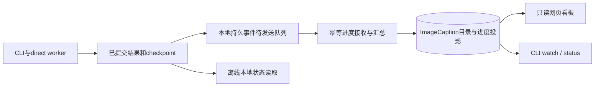
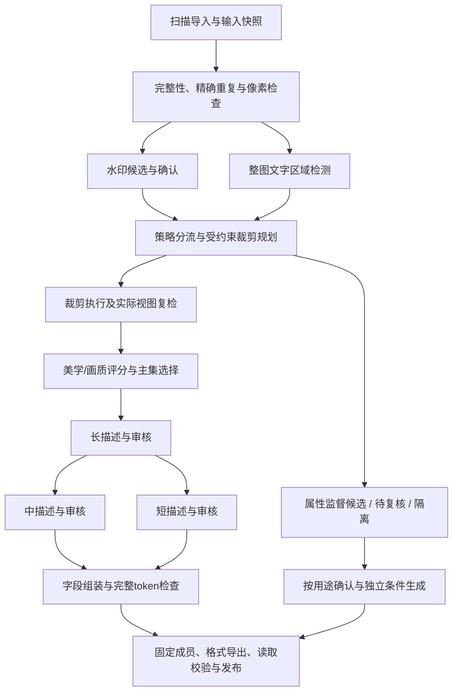

# Design

## Context

动机与交付范围见[proposal](proposal.md)。本change以ImageCaption的实际CLI使用方式为依据，规划保存在DataPipeline，运行时代码目标为ImageCaption。旧通用底座的21/70项完成记录保持独立，不能直接折算为本change进度。

已核对的工程入口及观察：

| 入口 | 观察 | 本设计落点 |
|---|---|---|
| ImageCaption GitHub快照`9e90b53037e466e91c0a64ab4fbac09be857a361` | 已有FastAPI、PostgreSQL、React、CLI/worker、direct batch和可验证导出 | 扩展现有产品，保留旧接口和策略 |
| `backend/curation/progress.py`、`frontend/src/RunProgress.tsx` | 按数据库任务聚合，非图片阶段主要统计操作次数；阶段明细默认折叠 | 增加内部工作量、默认阶段卡片和direct CLI上报 |
| `frontend/src/RunActivity.tsx` | 部分变化记录依赖浏览器会话，不能充当持久运行历史 | 服务端持久事件，浏览器只读投影 |
| `tools/keyword_extractor/` | 有长描述压缩为短描述的独立工具 | 纳管并补齐中描述、字段状态和统一版本 |
| node95部署与批次自带脚本 | 部署HEAD为`11c6fcfd3726add321aef40c42716e04f363a8e5`；实际批次有独立裁剪脚本，不能只按GitHub入口推断运行方式 | 实施固定目标代码及脚本摘要，增设历史/新协议适配 |
| 最近批次的只读几何核查 | 先选最大面积再检尺寸会遗漏其他可行矩形；候选框确认不足；没有整图文字面积门控 | 联合约束搜索、候选确认、文字检测与分流 |

上述批次核查未查看图片、真实caption或OCR内容；几何可行性不构成误检率或视觉质量结论。真实路径、逐图记录和批次统计不写入本仓库。MOSS的多粒度与属性条件证据见[研究依据](../../../docs/research-evidence.md)，本设计不宣称复刻其未公开训练流水线。

## Goals / Non-Goals

**Goals:**

- CLI启动后，终端和网页都能看到阶段、内部工作量、结果分布及等待原因；看板不参与模型执行。
- 主照片集保留用户要求的水印裁剪与大面积文字过滤，辅助属性用途有独立准入和条件。
- 同一原图、不同视图、不同标注和多次运行通过稳定身份管理；增加版本不重复复制全部数据。
- 新增功能按阶段接入，能够在质量模型接入前交付版本骨架与真实进度看板。

**Non-Goals:**

- 首版不重建完整网页操作台、不增加公开无认证服务，不要求从网页启动批处理。
- 不将全部holdout作为负样本，不自动构造原图/裁剪图偏好对，也不新增模型训练器。
- 不在本次规划阶段部署或修改历史图片；不把旧批次完成标记当作完整训练发布验收。

## Decisions

### 1. CLI执行与只读看板共用状态

沿用ImageCaption的CLI、控制API和PostgreSQL。direct执行器增加版本化事件适配；本地批处理继续写已验证结果和checkpoint，进度事件是这些提交事实的索引。数据库保存目录、运行登记和已接收的进度投影，网页不通过扫描大目录或解释任意stdout推断成功。



网络不可用时将事件留在本地待发送队列；本地watch显示本地来源，远端看板显示最后同步时间和过期标记。恢复后幂等补报，不补造断线期间的心跳。现有API鉴权和默认本地监听继续使用，远端浏览优先通过已有安全连接方式访问。

相比全程解析日志，此方式能确定工作身份和提交边界；相比再部署一套调度系统，直接复用现有控制面。原始日志保留为故障材料，不能成为唯一计数来源。

### 2. 数据版本、运行和产物身份

新增产品级数据集及版本目录，与既有batches、runs、assets、occurrences、derived_assets、exports建立映射。通过增量迁移接入旧数据库，不直接创建另一套同名资产表。

| 身份 | 固定内容 |
|---|---|
| dataset_id | 长期数据集与来源关联 |
| dataset_version | 人类可读`v0001`等序号、内部ID、父版本、构建意图及变更说明 |
| run_id / attempt_id | 一次冻结构建与其重试尝试；重试不递增数据版本 |
| view_id | 原始身份、变换配置、实际输出SHA与几何 |
| observation / annotation | 视图、模型、模板、配置、状态、父结果和审核引用 |
| export_id | 固定数据版本、格式、caption模式、产物校验 |

版本在计划创建时事务预留，允许序号有失败记录或空缺但不复用。状态为draft、building、validating、ready、failed、withdrawn；明确区分`image-prepared`与`training-dataset`产物类型。版本内容改变产生新版本；仅重新打包产生新导出。每个版本包含主集、辅助候选、待复核和隔离清单及相互对应关系。

物理对象按内容摘要复用。只读引用可用于内部消费，可移植导出按需复制/分片；可变源文件不能直接作为可信不可变对象。旧硬链接产物纳管时记录来源与可变性，未重验实际输出摘要不提升为新协议的已验证版本。主集和辅助原图共享亲缘组，切分时防止跨训练/验证泄漏。

### 3. 阶段图与失效范围



此图是目标阶段图，分支可以并行；看板不能把它降为只有一个活动步骤的固定线性进度条。旧策略仍有原阶段序列，新流程按冻结策略声明启用/跳过节点。未选辅助训练时，辅助候选保留为目录产物，不阻塞主集发布；但主集本身必需审核或失败未解决时不得ready。

缓存键包含输入视图、算子、模型/权重、模板和配置。阈值变化重做决策；水印确认变化重做相关规划/视图；视图变化使相关评分和标注失效；摘要模板变化只重做该变体及其条件组装。人工改判保留旧事件；若重新打开已终结工作，显式记录新的阶段代次，不能偷偷重置进度。

### 4. 水印裁剪与文字门控

检测召回阈值和确认/自动处理门槛分别配置，保留每个候选框的完整置信与坐标证据。低置信、异常全图框和不稳定结果进入复核；OCR是辅助证据，空OCR不否定图形水印。新自动处理门槛经审核集校准后冻结，不能照搬旧候选阈值。

裁剪规划先建立确认框及安全边距，在可行集合中同时约束尺寸、保留面积、允许区域和格式；再按保留面积及确定性规则排序。输出记录计划矩形和实际矩形。JPEG系数裁剪对齐失败时，仅采用策略允许且满足约束的替代格式；全流程保存实际输出摘要。几何无交叉、残余水印复检和主体/监督一致性是不同检查。

文字检测覆盖整图，至少记录`text_union_area_ratio`与`largest_text_block_ratio`。坐标先按实际画布裁边，重叠区域只算一次；局部分组使用固定规则，不能用全局文字外接框吞并大片空白。大文字主集过滤先在原图执行，裁后再重算或复检。检测失败、无文字、异常框分别表达；阈值为待校准参数，不预置假定有效的百分比。

### 5. 质量分级、辅助用途与三档描述

像素、技术画质、美学分别保存；原图和视图观测不能混用。实际训练视图完成后再做精细评分，可在前面用廉价观测路由。按领域和用途冻结分类、门槛与人工覆盖；高像素不自动等于高美学。

每个样本有一个主路由和多个原因：主集、辅助候选、待复核、隔离。水印确认但无法合格裁剪的原图可进入属性候选；大文字是独立属性；仅尺寸不足不证明水印缺陷。辅助样本需要单独满足来源、画质、属性证据、条件和适配器要求。记录到名为negative的目录不构成训练监督，也不将原图/裁剪图直接充当同条件偏好对。

第一版复用长描述适配器，在实际视图上产生并审核长描述，扩展现有摘要器生成中/短描述。生成状态和事实审核独立，短中描述保留父标注。后续可对照一次生成三档的VLM，但不作为首版依赖。正常图中文字与水印等属性分开保存；旧水印专用模板保持历史兼容，新模板不无条件省略所有正常文字。

条件构建顺序为选择变体、投影/拼接属性、套目标模板、使用目标tokenizer检查完整长度，保存最终条件摘要。固定TXT导出只选择一档；随机混合需要实际训练器适配，不能默认把三档变成三倍图片。MOSS的比例和长度分布属于文献事实，不自动成为默认配方。

### 6. 进度契约和恢复

事件至少带`schema_version / dataset_version / run_id / stage_id / stage_generation / substep_id / partition_id / attempt_id / seq / emitted_at / unit / total_known / total / result_checkpoint_ref`。传输事件可重发，服务端记录接收时间；本地或远端聚合器均从同一结果身份和checkpoint口径恢复计数。

每个分片尝试写独立产物；协调器固定当前有效尝试代次。已提交、已验证的工作ID才可进入计数。重复事件和旧序号不增加数量，过期尝试不替换当前投影；校正或人工重新打开结果保留原因及代次。不能对多个worker的历史累积数简单相加。对direct模式采用单分片单有效写者，断线期间旧尝试只可写其隔离目录，恢复并校验后才能被接纳。

同一阶段当前主结果互斥，定义：

```text
resolved = passed + routed_out + review_pending + failed_final
total = resolved + running + retry_wait + pending
处理进度 = resolved / total                 # 只在total已知且大于0时显示
重试次数、附加原因数、已复用结果数            # 独立统计，不再次加入resolved
阶段验收 = 所需结果与审核满足该阶段的契约      # 不能由百分比推导
```

`passed`指该阶段通过，不等于训练发布通过；`routed_out`是正常分流，不是执行失败。`review_pending`已产生可审结果但未获准入；配置要求审核时阶段状态为waiting_review。仅某个辅助分支待复核不必阻塞无关联主集阶段。caption同时提供三个变体分母和“三档合格图片数”，避免父阶段重复累计同一张图片。

扫描阶段未知分母显示“已发现/已处理”；扫描结束冻结下一阶段输入。文件复制和校验计文件/字节，模型加载显示加载子步骤；无法测量内部进度时明确“不提供百分比”。没有合格输入时显示`empty_input`及路由结论。默认不生成全流程百分比，展示已验收阶段数、各活动阶段和关键阻塞。

速率建议使用最近60秒的新增已提交工作，冷启动、重连和暂停后先积累有效窗口；缓存复用瞬间的跳增不用于推理吞吐估算。ETA仅在已知总量和有效速率下估算并注明单位/窗口。心跳与最后有效进展分开记录，长耗时子步骤可以有心跳但无结果增量。首版建议5秒刷新、按阶段配置过期与无进展提示，实测后调整；这些是目标配置，不是已验证性能。

### 7. 看板与CLI交互

首版扩展现有React进度页与查询API，不新建独立前端项目。看板默认展示运行列表、阶段卡片和当前子步骤；详情展开分片/节点、结果原因和尝试记录。默认只显示匿名工程信息，无图片、caption或OCR预览。网页为只读，开始/暂停/恢复沿用CLI，避免引入第二套控制语义。

拟议CLI能力（尚未实现，最终命令需兼容现有解析器）：

```text
ics dataset import-legacy ...
ics run status <run-id> --json
ics run watch <run-id>
ics versions diff <version-a> <version-b>
```

页面示意，以下全部为合成数字，不表示任何真实批次正在运行：

```text
数据集 demo-images  |  v0002  |  run-demo-02  |  运行中
当前阶段：水印裁剪   子步骤：输出校验   数据更新：3秒前
已提交结果 18,240 / 24,000 张（76.0%）
通过 17,800  分流排除 300  待复核 120  最终失败 20
运行中 16  待处理 5,744  重试等待 0
速率：窗口不足，暂不可估计   ETA：待估计
阶段验收：未完成；复核/失败详情可查看
```

阶段卡片覆盖扫描、去重/像素、水印检测/确认、文字检测、裁剪规划/执行/复检、美学、长/中/短描述及审核、条件组装、打包/实际读取。多节点显示节点身份、当前阶段、最后心跳和各自分片，不将断联显示为持续可信运行。API提供快照修订号和有界事件游标，首版轮询即可；相比优先建设WebSocket，轮询更容易验证恢复与一致性。

旧进度接口由兼容适配提供原字段，不改变旧客户端含义；新字段使用新版本响应。旧direct历史批次通过只读导入显示已核实结果，并标识`legacy_snapshot`。对未改造且正在运行的旧脚本，只能报告可验证checkpoint和元数据来源，不能推算不存在的实时子步骤、速率或ETA。

### 8. 实施边界与验收顺序

2026-10-22首版实现落在完整ImageCaption checkout，新增`ics workbench prepare/create/list/status/watch/sync`及`#workbench`页面。该增量接通版本骨架、CPU准备入口和一个既有direct入口；上述目标架构中的完整谱系、阶段代次重开、全部算子与训练发布仍待实施。实际实现与任务证据见[首版记录](../../../docs/imagecaption-v0.2-status.md)，不能将本设计全部段落解释为v0.2已实现。

P0核对目标完整checkout的基线、API/表迁移和旧CLI兼容，创建版本/运行骨架与合成夹具。P1优先交付内部进度、终端watch和只读网页看板，接通现有处理阶段。P2完善水印确认/联合裁剪及整图文字过滤。P3接入美学和分流。P4纳管三档描述、最终条件和导出。P5做小批与恢复验收。

规划文件在DataPipeline同步；实施需在ImageCaption工作目录绑定这份规格及明确的代码基线，再执行apply。源仓库现有schema/sql、CLI解析器与direct脚本必须走兼容迁移，不能以本仓库的通用底座测试通过代替目标集成测试。历史脚本/数据只读纳管，不在生产目录试验覆盖。

## Risks / Trade-offs

- [日志存在但没有真实提交] → checkpoint及结果身份校验，stdout和完成标记只作线索。
- [重试和重复上报使进度超过100%] → 工作集合、尝试代次、幂等事件和互斥主结果计数。
- [看板离线仍显示运行] → 源事件时间、接收时间、心跳和最后进展分开，明确过期状态。
- [整图文字误检造成过度排除] → 面积几何校验、低置信复核、领域校准和多原因记录。
- [裁剪几何合格但主体受损] → 视觉审核与视图监督匹配独立验收，不把纯几何计数当收益。
- [带印原图污染主集或评测] → 用途与亲缘组固定，辅助条件实际读取验证。
- [旧记录缺失摘要或配置] → 保留unknown及历史声明，补验独立追加，不伪造完整谱系。
- [观测本身拖慢海量处理] → 有界缓冲、分片checkpoint和增量聚合，避免每次刷新重扫图片/JSONL。

## Migration Plan

1. 在ImageCaption完整checkout中记录基线，备份数据库及目录配置，用合成数据演练增量迁移与旧CLI回归。
2. 导入历史运行索引及已知产物类型；未知字段保留未知，原始输出不改名、不移动、不重编码。
3. 新CLI以显式新策略启动，先接入进度；看板显示新协议实时记录与旧历史快照的不同证据等级。
4. 各新算子逐步上线，版本策略固定新增依赖；模型未校准时允许观测/复核，但不假称筛选已验证。
5. 终止worker、重复事件、网络中断、旧worker迟到、checkpoint损坏及浏览器重连均需恢复测试。
6. 回滚使用旧CLI/策略和旧已发布版本；迁移保持旧字段可读，新产物保留审计，首次上线不做破坏性删表或清理。

## Open Questions

实施校准时填写具体美学/文字模型、自动确认及面积阈值、目标训练器、资源并发、进度刷新与过期时限。它们通过已定义的适配器和配置进入版本，不改变上述行为契约；未填写或未测的路径保持待配置/待校准状态。
