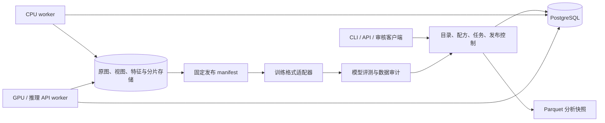

# Design

## Context

见 proposal.md 的动机和能力范围。2026-10-15 检查时远程仓库为空，没有需要兼容的既有代码或数据表。本次产物是待实施设计，不是运行系统；主规格目录在实施验收与 archive 前保持为空。

已知开发环境为 Windows、Python 3.12、Node；生产 GPU、存储、数据规模尚未提供。设计采用可配置资源池与存储后端，不据此假定吞吐或训练容量。单机运行与分布式运行共享数据契约；生产服务首选 Linux 容器，Windows 支持开发与本地 CPU 调试。

## Goals / Non-Goals

**Goals:**

- 资产级去重与来源级追溯共存；按任务、领域和训练阶段生成独立数据产品。
- 为 T2I、OCR/排版、编辑、多参考、RGBA、风格 LoRA 与偏好任务提供明确契约。
- 失败后可恢复，结果幂等、可追溯，发布结果可以被真实训练加载器消费。
- 通过人工审计和固定预算模型对照，证明筛选与补数的收益。

**Non-Goals:**

- 本次不实现采集爬虫、模型训练器、GPU 服务或审核网页；后续任务明确安排运行时。
- 不复刻模型团队未公开的数据集、比例或闭源系统；不承诺无来源证据的完整训练配方。
- 首版不建设自研分片数据库、独立 Kafka 集群或全量向量在线检索服务。

## Decisions

### 1. 分离控制平面、数据平面与模型执行



PostgreSQL 同时承载初期元数据与持久任务，减少双系统一致性问题；文件系统/S3 兼容后端承载大对象，数据库只保留引用和摘要。批量分析用 Parquet 快照与 DuckDB，向量离线检索用 FAISS 适配器。Spark/Ray 可在量级和压测证明必要时作为计算执行后端接入，不能成为数据状态的唯一存储。

替代方案：图片存数据库使备份和 IO 成本膨胀；只使用目录与 JSON 难以处理并发任务、审计和多版本引用；立即采用复杂消息系统会增加恢复边界。这里选择先保持一个事务型状态源。

### 2. 数据实体与不变量

| 实体 | 主键/唯一性 | 关键内容 |
|---|---|---|
| assets | asset_id = 原始字节 sha256 | uri、byte_size、mime、created_at、访问域 |
| source_records | source_id；批次+源标识+资产唯一 | 来源 URI、批次、授权证据引用、许可状态、获取时间 |
| views | view_id = 输入与变换摘要 | asset_id、parent_view、裁剪框、尺寸、方向、插值、alpha策略、产物摘要 |
| observations | observation_id；任务+结果类型唯一 | subject_ref、模型/配置摘要、分数或特征对象 URI、置信信息 |
| annotations | annotation_id | subject_ref、字段、语言、文本/结构、模型与模板摘要、父标注 |
| reviews | review_id | 被审字段/样本、判定、原因、审核者类型/版本、人工裁决关系 |
| duplicate_edges / clusters | edge_id / cluster_version | 算法、相似度、阈值、候选、确认结果、成员 |
| task_samples / sample_images | sample_id / sample+role+ordinal | task_type、input/target/reference/mask角色、instruction、关联组 |
| recipes / decisions | canonical config sha256 / decision_id | 输入快照、版本化规则、选样结论、观测引用、原因码 |
| jobs / attempts | idempotency_key / attempt_id | 依赖、状态、资源、租约、attempt_token、退避、错误、预算 |
| releases / members / shards | release_id / sample+split / shard_id | 固定 manifest、checksum、配方、划分、ready/withdrawn状态 |
| evaluations / acquisition_requests | evaluation_id / request_id | 基线、能力标签、错误、补数目标、成本和对照版本 |

公共 envelope：schema_version、created_at、producer_version、subject_ref、config_digest。时间保存为 UTC，界面再转换时区。标注、观测、决策追加新版本；不原位覆盖旧结论。数据库使用外键与唯一约束，不能仅靠应用层约定。

资产字节重复不合并来源记录。相同画面不同编码可以形成重复簇但仍是独立资产。一个资产可参与多个任务、多个视图与多个发布。唯一样本数、唯一资产数、物理字节数、预期训练样本次分别统计。

特征存储带模型摘要和维度；不同编码器或权重生成的向量禁止混在同一相似度索引。发布固定引用的标注与审核版本，而不是查询“最新 caption”。

### 3. 算子接口与依赖图

每个算子声明：输入/输出 schema、operator_version、model_digest、config_digest、资源类别、batch 上限、输入像素/token限制、外部服务策略。执行结果包含 observations、artifact_refs、errors、usage；算子不直接改变全局接受状态。

逻辑依赖：

```text
source registration → raw ingest → decode/probe → exact dedup
                                      ├→ basic features → coarse routing
                                      ├→ OCR → text/layout annotation
                                      └→ embedding → duplicate candidates / coverage
annotation + review + observations → recipe selection
selection → view planning → view annotation/check → split → shards → loader verification → ready
```

图像级 OCR 可用于廉价路由；发生裁剪后，坐标需变换并复核，必要时重新 OCR。全图标注只在证明与训练视图一致时复用。运行时随机裁剪仅用于能生成对应条件或经验证不破坏监督的路径，不能靠固定视图审核覆盖任意增强。

### 4. 持久执行、原子提交与恢复

任务身份为 SHA256(canonical(input_refs, operator_version, model_digest, config_digest))；canonical 使用排序键 JSON，禁止 NaN 与无版本默认参数。批处理可变，样本级提交身份不变。

状态：pending → leased → succeeded；临时故障到 retry_wait，永久错误或次数耗尽到 quarantined，可由审计操作重放；cancelled 不删除已有产物。观测缺失使用 null/未产生状态，不能用质量分 0 表示。

领取用短事务与 FOR UPDATE SKIP LOCKED，写入 owner、lease_expires_at 和单调 attempt_token，事务外执行推理。续租和提交必须匹配 token 且租约未失效。数据库时间作为租约依据。任务完成和下游可见性同一事务提交。

对象先写临时键，计算校验值后提升为内容寻址的不可变对象；文件后端使用同文件系统原子替换，对象后端不依赖 rename。数据库事务引用已验证对象；跨存储无法提供真正分布式原子性，通过 staging、条件提交、幂等与延迟 GC 收敛。发布仅从已提交引用读取。GC 设置保留窗口，保护在途任务、固定发布和法律保留引用。

重试错误分类：网络/限流/临时存储失败退避重试；损坏输入、schema无效、明确不兼容为永久错误；OOM 可减少 batch 有限重试。退避上限、尝试次数、并发与预算均配置化。API 请求无法普遍保证外部 exactly-once，使用供应商幂等键与本地调用账本，记录不确定结算窗口，成本报告包含重试。

配置或模型升级生成新任务，沿依赖摘要仅失效受影响节点。调度支持按批次暂停、资源池限额、失败隔离、队列积压与 worker 心跳。部署升级采用 expand/contract 迁移，先兼容旧 worker 再切换版本。

### 5. 分层去重与划分

字节级 SHA-256 全量执行；感知哈希仅生成候选，结合颜色和领域验证；embedding 近邻在局部簇中召回，再按任务决定保留。相似度阈值通过标注候选校准，单一 CLIP 相似度不直接当事实正确性证明。

重复关系分为候选、已确认近重复、任务允许变体。划分时在固定关系图快照上连接：已确认重复、派生亲缘、编辑组、多参考关联、显式来源组；连通分量按 seed 哈希分配。若出现超大分量，转人工复审或隔离，不拆开以强行满足比例。新发现跨集合关联会使发布校验失败并进入修复，历史版本记录污染事件。

替代方案：按文件独立随机划分容易把原图、裁剪图或编辑目标泄漏到验证集；只按语义聚类划分又会把大量相关但独立的图捆绑，损害分布。因此只连接具有数据亲缘或确认重复证据的关系。

### 6. 任务协议、标注与审核

| 任务 | 必需信息 | 关键审核 |
|---|---|---|
| image-only | target、condition_strategy、模型能力声明 | 条件由实际视图生成；不等于空 caption |
| T2I | target、caption_variant、language | 可见主体、属性、关系与视图一致 |
| text-rendering | target、逐字原文、polygon、阅读顺序 | 错字、漏字、布局、缩放后可读性 |
| edit | source、target、instruction、preserve_constraints | 修改方向、非目标区域、身份保持 |
| multi-reference | 有序 references、角色、target、instruction | 输入关联、参考顺序、内容泄漏 |
| transparent | RGBA target、alpha语义、背景处理记录 | 前景边缘、半透明、杂色 |
| style-lora | target、内容描述变体、trigger与策略版本 | 主体多样性、风格泄漏与触发词 |
| preference | 同条件、chosen/rejected、生成与裁决记录 | 条件一致、位置偏差、裁决可追溯 |

标注链：通用低成本路由 → 专用模板 → schema检查 → 字段审核 → 不确定样本人工复审。支持短中长、多语言、文字、布局、知识、实体关系分开存储。知识字段必须引用可信外部元数据；视觉模型猜测只可作为候选。短 caption 的生成不得引入长 caption 没有的新事实。

审核与生成可以使用不同模型；同模型自审存在相关偏差，人工审核集用于测量。OCR 系统对不支持语言返回 unsupported，不返回“无文字”。人工裁决不可覆盖原始模型结果，只追加 override 及原因。目标 tokenizer、模板和特殊 token 规则属于导出适配器配置。

审核工作台首版可由 CLI 导出复审 JSONL 与缩略图索引，再导入带审核者和版本的结果；后续网页客户端使用相同协议。批量自动接受阈值必须在人工基准上校准。

### 7. 模型经验到策略的映射

详细证据与边界见 docs/research-evidence.md。这里仅定义实现落点：

| 经验 | 工程落点 | 不允许的泛化 |
|---|---|---|
| LLaDA：先视觉能力后图文对齐，关注实际裁剪 | image-only 能力检查、视图条件一致性、延后昂贵标注 | 普通 T2I 训练直接省 caption |
| Qwen：任务化描述与统一编辑 | 通用/文字/知识/结构化字段，多图角色，错误标签 | 把 2.0 配方写成 2.1 已公开事实 |
| Qwen 2.1：透明与多参考能力 | RGBA、alpha、输入序列、模型适配声明 | 所有后端自动支持 RGBA |
| Krea：多样性、分阶段处理、标注成本分层 | 各阶段阈值、覆盖审计、专用小模型接口 | 单一美学分排序决定全部数据 |
| FLUX：Base 微调与风格 LoRA caption | 目标 checkpoint、caption投影、触发词 | 特定风格教程等于通用预训练配方 |

### 8. 配方与课程

配方分 raw eligibility、task annotation、view policy、field review、selection、sampling、split、export 八层；解析后冻结所有默认值。先做校准 dry-run，输出分数分布、边界抽样、每关淘汰、领域变化、预计 GPU/API 消耗，再允许构建。

预设候选：broad-visual、t2i-general、text-layout、edit-single、edit-multi、transparent、style-lora、preference。它们是待校准工程模板，不是已验证训练比例。256/512/1024 等课程是目标面积与 bucket 策略，禁止强制把全部输入拉伸成正方形。具体尺寸需满足目标 VAE/patch 对齐要求；是否允许放大单独配置。

真实/合成/未知三态独立；原始声明和检测器估计分别保存，分类器不能证实来源真实性。合成数据记录教师、checkpoint、prompt、seed、生成配置与过滤版本。偏好数据和 RL rollout 后续共用谱系结构，但在线 RL 训练器不属于本框架。

### 9. 发布、缓存与训练交付

manifest 作为权威交换契约，至少含 sample_id、task_type、images(有序角色/uri/checksum/view)、caption_ref、instruction、split、group_id、recipe_digest、annotation/review_refs、sampling信息、schema_version。向量和大标注使用对象引用。示例见 docs/contracts.md。

release 状态为 draft → building → validating → ready，可失败恢复或 withdrawn。构建开始冻结输入快照；在检查分片校验、成员唯一性、关联组、字段完整性、来源策略、真实加载器后，事务中设置 ready 指针。消费者只消费 ready 且未撤回版本。源撤回触发影响分析并撤回受影响发布；如果仍有独立可用授权来源，重新评估并生成新版本。

实现顺序：JSONL manifest + 目录图片/txt 导出 → WebDataset tar 分片 → 按真实训练器需要扩展 Parquet 或编辑格式。manifest 支持复杂任务，但 sidecar 适配器只承诺 T2I/指定 LoRA，遇到编辑/多图不得悄悄丢字段。

分片目标字节数、每片样本上限、压缩策略和并行度通过训练加载压测选择。shuffle、bucket batch、epoch重复、drop_last、distributed sampler 由适配器记录；报告逻辑成员数与实际加载样本次差异。发布抽检与训练端首 epoch 验证分开执行。

latent/文本编码缓存必须绑定视图、VAE/tokenizer/text encoder、caption、dtype 和增强版本，不允许跨不兼容模型复用。首版可不缓存，避免随机增强与缓存不一致；启用时先验证语义与数值兼容。

### 10. 接口、包边界与配置

建议后续 Python 包布局：domain（契约）、storage（文件/S3）、catalog（事务与迁移）、execution（任务）、operators（特征与推理）、curation（配方与去重）、datasets（任务）、releases（导出）、evaluation（审计）、interfaces（CLI/API）。依赖方向为 interfaces → services → domain，推理和存储通过适配器隔离；模型依赖放独立可选环境。

拟议 CLI（尚未实现）：

```text
idp ingest --source-config ...
idp run --pipeline ... --batch ... --budget ...
idp jobs inspect|retry|pause ...
idp audit export|import ...
idp recipe validate|dry-run ...
idp release build|verify|withdraw ...
idp evaluate data|model ...
```

API 后续采用 FastAPI：/v1/assets、/jobs、/reviews、/recipes、/releases、/evaluations；创建/构建支持 Idempotency-Key，列表 cursor 分页。写接口区分操作者、审核者和发布者权限；默认本地监听，远程接入必须认证。外部推理服务访问原始图需由来源策略显式允许，凭据只从环境/密钥服务读取。

### 11. 审计、容量与验收

数据指标：各关数量漏斗、字段错标、误删、重复、主体裁切、文字可读、来源集中、风格/概念覆盖、泄漏。工程指标：stage输入/输出、成功/失败/重试、queue age、样本耗时分位、GPU秒、API费用、存储放大、训练数据等待。日志只记录安全标识与错误码，不记录完整 OCR/图片/凭据。

人工审核按来源、领域、分数区间与拒收原因分层，边界样本过采样但记录入样概率。比例报告用加权估计与置信区间，不预设“1000条就足够”。模型比较固定底模、预算、seed、提示与评测协议，并记录唯一样本与训练样本次，避免用 loss 下降替代能力提升。

容量实测公式：每阶段 GPU小时 = 输入数 × 单样本GPU秒 / 3600；端到端耗时取依赖路径和各资源池瓶颈，不能把并行阶段简单相加。总存储 = 原图 + 派生视图 + 标注/向量 + 发布分片 + 临时产物 + 保留副本；费率、成功率、重试和配方保留率一起进入预算。

性能目标由 M0/M1 基准产生，验收门槛：重复接入幂等、崩溃恢复不丢成员、过期 worker 无法提交、组级泄漏为零、必需字段和校验通过率100%、未授权来源不发布、真实加载器成功。标注精度与吞吐阈值须依据人工基准和实际硬件配置后冻结。

## Risks / Trade-offs

- [美学过滤抹去长尾] → 保留观测，领域化阈值与前后覆盖审计。
- [语义去重删除有效变体] → 候选与判定分离，任务保护与人工边界集。
- [单数据库队列成为瓶颈] → 分资源索引、批量领取、控制事务长度；先压测再分区或换执行后端。
- [生成与审核模型共同幻觉] → 人工金标、模型版本追踪、独立专项检测。
- [跨存储提交中断] → staging、fencing token、幂等引用和延迟回收。
- [大关联组导致比例偏移] → 报告分量分布并隔离复审，不破坏防泄漏边界。
- [源码同步误含真实数据] → ignore、提交前检查；Git 只管理小型合成夹具。
- [公开资料不等于完整配方] → 证据表标注来源、阶段和未知，不复制未披露比例。

## Migration Plan

1. 当前：提交 OpenSpec 提案、十项规格、设计、证据、数据契约和实施清单，校验通过后同步 Git。
2. M0：建立合成测试夹具与实际数据抽样协议，冻结 schema 和基准；不先全量标注。
3. M1：落地本地存储、PostgreSQL、持久执行与 manifest/sidecar；跑通小批真实数据闭环。
4. M2：引入 OCR/caption/embedding 等版本化适配器与人工审核；冻结校准后配方。
5. M3：完善编辑/多参考/RGBA/偏好与 WebDataset，用实际训练器验收。
6. M4：训练对照、补数闭环、容量压测与备份恢复；完成任务才 archive。

每阶段独立迁移与恢复演练。回滚通过旧 worker 镜像、旧配方及旧 ready 发布引用完成；新格式不覆盖旧产物，数据库破坏性变更延后。备份必须同时覆盖数据库、对象版本和加密配置，并在隔离环境恢复验证。

## Open Questions

以下均为实施时填写的部署参数，不改变上述契约：数据规模、CPU/GPU数量、存储后端与区域、选用推理模型和服务、成本上限、首个训练器及领域配比。若后续需要更改能力范围或外部行为，应新建 OpenSpec change，而不是以配置名义绕过规格。
